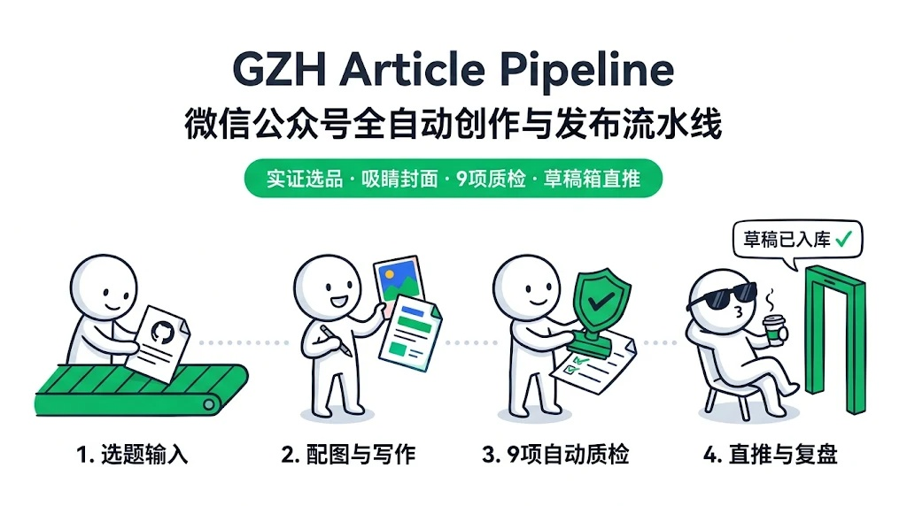
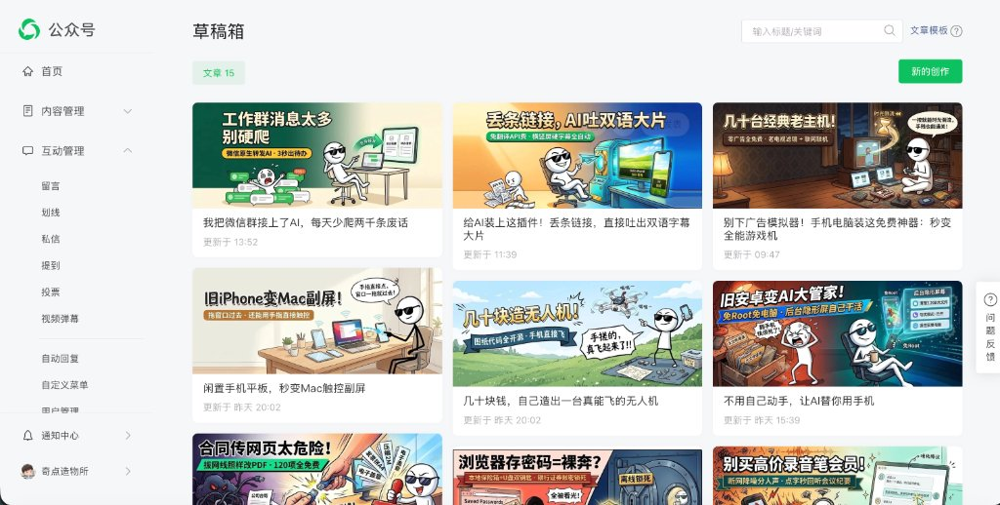
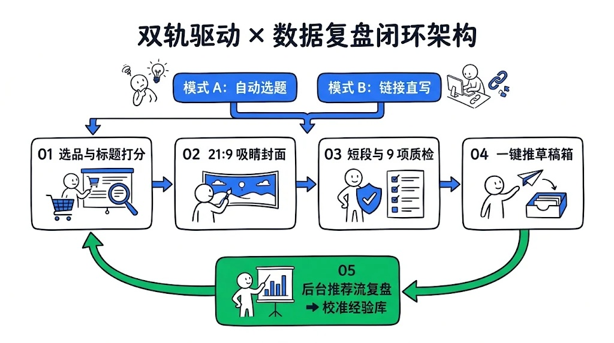
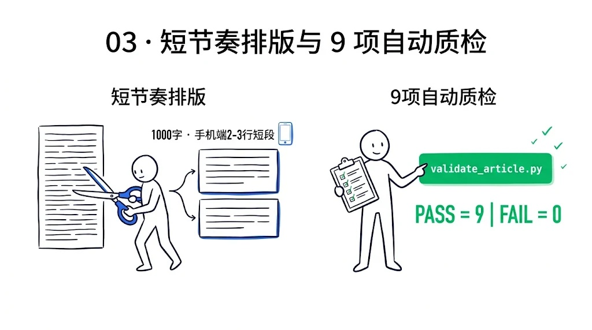
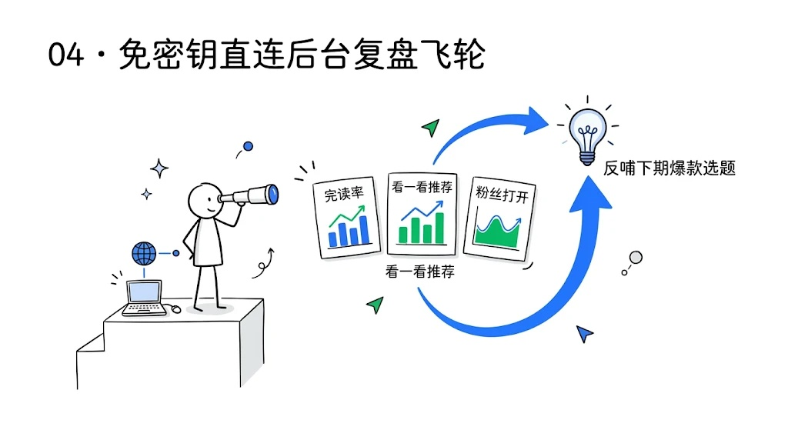
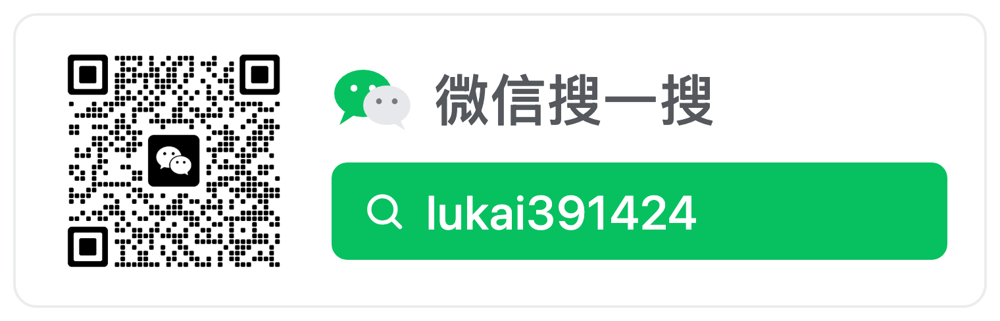

# GZH Article Pipeline

<p align="center">
  <a href="README.md">简体中文</a> • <strong>English</strong>
</p>

<p align="center">
  
</p>

<p align="center">
  <a href="LICENSE"></a>
  <a href="https://github.com/openai/codex"></a>
  <a href="https://deepmind.google"></a>
  <a href="https://docs.anthropic.com/en/docs/claude-code"></a>
  <a href="https://mp.weixin.qq.com"></a>
  <a href="https://github.com/lukaizj/gzh-article-pipeline/stargazers"></a>
</p>

<p align="center">
  <b>End-to-End WeChat Official Account Pipeline: Topic Gating, `21:9` Covers, 9-Point QA, Draft Push & Analytics</b><br>
  <sub>Refined from ~180 published articles on "奇点造物所". Built for Codex, Antigravity, and Claude Code.</sub>
</p>

<p align="center">
  <a href="#showcase">Showcase</a> •
  <a href="#features">Features</a> •
  <a href="#quick-start">Quick Start</a> •
  <a href="#installation">Installation</a> •
  <a href="#contact">Contact</a>
</p>

---

## Showcase

Real articles generated end-to-end by this pipeline and pushed into the WeChat MP **Draft Box** (live screenshot, draft-only—never auto-published):

<p align="center">
  
</p>

---

## Features

- **Dual-High Topic & Title Gate**: Verifies repo liveliness before drafting, prioritizes high-eCPM verticals, and enforces `<= 26` char jargon-free titles (`< 75/100` rejected).
- **Short-Rhythm Copy & 9-Point QA**: Targets `950~1300` CJK chars with 2–3 line mobile paragraphs; `validate_article.py` offline-checks buzzwords, banned terms, and inline HTML integrity.
- **Story `21:9` Covers & `429` Failover**: Generates custom full-bleed `21:9` covers per narrative and seamlessly fails over to local Chrome Gemini Web on API `429` quota errors.
- **Draft & `newspic` Safe-Crop Push**: Outputs pure inline HTML to WeChat CDN (`--update-draft` supported); `upload_newspic.py` enforces `<= 20` char titles, center safe-zone framing, and `203×270` live card checks.
- **Keyless Backend Analytics**: No `appid`/`appsecret` needed—`pull_and_analyze_mp.py` reuses your signed-in Chrome session to pull completion & recommendation channel splits.

<details>
<summary><strong>Expand: Architecture Diagrams, Module Breakdown & Empirical Insights (~180 Articles)</strong></summary>

<br>

```text
[Auto Topic Mining / URL]
           │
           ▼
[21:9 Cover (API + 429 Web Failover)] ➔ [Inline HTML + 9-Point QA] ➔ [upload_to_wechat Draft Box]
           ▲                                                                       │
           └────── [Empirical JSON] ◄──── [pull_and_analyze_mp Keyless] ◄──────────┘
```

<p align="center">
  
</p>

| Topic Gate & Title Scoring | `21:9` Cover & `429` Failover |
| :---: | :---: |
|  |  |
| **Short-Rhythm Copy & 9-Point QA** | **Keyless Local Backend Analytics** |
|  |  |

> Note: "Web Pro 自动接管" in diagram 02 refers to failing over to your signed-in Chrome Gemini Web session on macOS.

**3 Empirical Rules from ~180 Published Articles:**
1. **Sequential Gate Funnel**: WeChat algorithms evaluate `0–30m` public CTR ➔ `30–120m` completion rate ➔ `2–24h` share rate in strict order.
2. **High Shares ≠ Distribution**: A 2,600-char router guide hit a `25.96%` share rate but `0.0%` recommendation traffic because jargon hurt CTR and length tanked completion (`< 20%`).
3. **Dual-High eCPM × CTR**: Prioritize high-RPM verticals (office, finance, knowledge) wrapped in everyday, zero-jargon action hooks.

</details>

---

## Quick Start

| Use Case | Prompt / CLI Command | What It Does |
| :--- | :--- | :--- |
| **Ideation** | `Pick 3 WeChat article topics for today` | Suggests 3 high-fit topics calibrated to past data |
| **URL to Draft** | `Use gzh-article-pipeline to write: <URL>` | Verifies repo, drafts, illustrates, runs QA, pushes draft |
| **Little Green Book** | `Use gzh-article-pipeline to create a newspic post: <topic>` | `<= 20` char title, safe-zone crop, `203×270` check |
| **Offline QA** | `python3 gzh-article-pipeline/scripts/validate_article.py --input article.html --title "Title"` | Zero-key 9-point check & title scoring |
| **Analytics** | `python3 wechat-content-analysis/scripts/pull_and_analyze_mp.py --limit 30` | Pulls traffic split from signed-in Chrome `mp.weixin.qq.com` |

> Prefer copy-paste prompts? See [`CLIENT_PROMPT_CARD.en.md`](CLIENT_PROMPT_CARD.en.md) ([中文版](CLIENT_PROMPT_CARD.md)).

---

## Installation

**One-line install via Codex / Antigravity / Claude Code:**
```text
Please install this skill for me: https://github.com/lukaizj/gzh-article-pipeline
```

<details>
<summary><strong>Manual Install, Multi-Agent Paths, Tiered Requirements & Repo Tree</strong></summary>

**1. Tiered Prerequisites**
- **Zero-Config**: `Python 3.9+` runs `validate_article.py` & `olive_journal_template.py`.
- **Draft Push**: `pip3 install -r requirements.txt` (`requests`, `Pillow`) + copy [`config.example.json`](gzh-article-pipeline/references/config.example.json) to `config.json` with `appid`/`appsecret` (add public IP to WeChat MP whitelist) or export `WECHAT_APPID` / `WECHAT_APPSECRET`.
- **Keyless Analytics & `429` Web Failover**: **macOS + Google Chrome** (signed into `mp.weixin.qq.com` / `gemini.google.com`).

**2. Manual CLI Install**
```bash
git clone https://github.com/lukaizj/gzh-article-pipeline.git /tmp/gzh-pipeline
SKILLS_DIR="${CODEX_HOME:-$HOME/.codex}/skills"   # Claude Code: ~/.claude/skills | Antigravity: ~/.gemini/antigravity/skills
mkdir -p "$SKILLS_DIR"
cp -R /tmp/gzh-pipeline/gzh-article-pipeline /tmp/gzh-pipeline/wechat-content-analysis "$SKILLS_DIR/"
pip3 install -r /tmp/gzh-pipeline/requirements.txt
```

**3. Repository Tree**
```text
gzh-article-pipeline/
├── CLIENT_PROMPT_CARD(.en).md                # Natural-language prompt cards
├── requirements.txt                          # requests / Pillow
├── gzh-article-pipeline/                     # Full end-to-end publishing skill
│   ├── SKILL.md
│   ├── scripts/                              # upload_to_wechat / upload_newspic / validate_article / gemini_web_bridge / pull_and_analyze_mp
│   └── references/                           # topic_selection / writing_playbook / visual_system / olive_journal_template
└── wechat-content-analysis/                  # Standalone analytics skill
```

</details>

---

## Contact

Local-first by design (`.gitignore` excludes `config.json`, `account_empirical_profile.json`, and token caches). MIT Licensed—PRs, [Issues](https://github.com/lukaizj/gzh-article-pipeline/issues), and [Stars](https://github.com/lukaizj/gzh-article-pipeline) are welcome.

<table>
  <tr>
    <th align="center" width="50%">WeChat Official Account: 奇点造物所</th>
    <th align="center" width="50%">Maintainer WeChat (note <code>开源</code> or <code>部署</code>)</th>
  </tr>
  <tr>
    <td align="center"></td>
    <td align="center"></td>
  </tr>
</table>

<details>
<summary><strong>WeChat Community Group & Sponsorship</strong></summary>

| AI Tools WeChat Group | Sponsor |
| :---: | :---: |
|  |  |
| **Scan to join (if expired, add maintainer WeChat with note <code>开源</code>)** | **Buy the author an iced Americano** |

</details>
