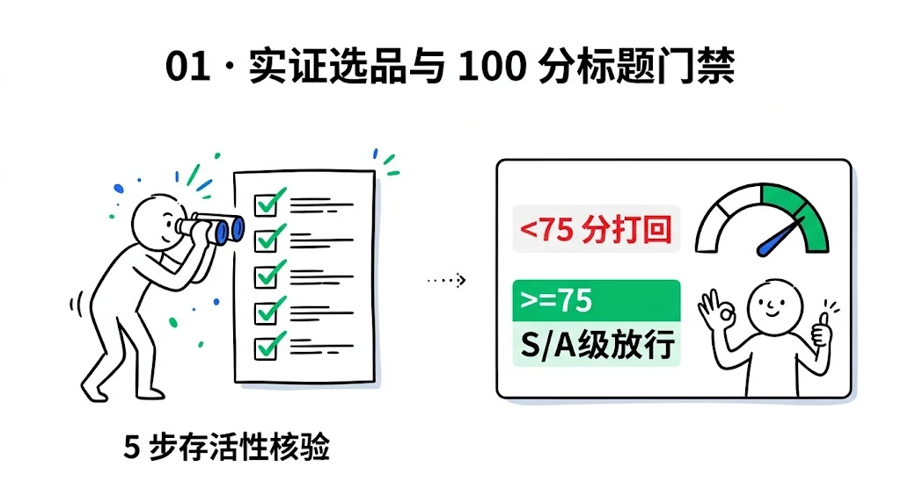
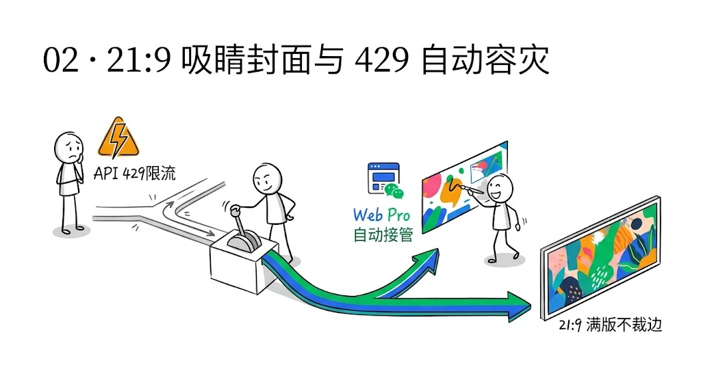

# GZH Article Pipeline

<p align="center">
  <a href="README.md">简体中文</a> • <strong>English</strong>
</p>

<p align="center">
  
</p>

<p align="center">
  <a href="LICENSE"></a>
  <a href="https://github.com/openai/codex"></a>
  <a href="https://deepmind.google"></a>
  <a href="https://docs.anthropic.com/en/docs/claude-code"></a>
  <a href="https://mp.weixin.qq.com"></a>
  <a href="https://github.com/lukaizj/gzh-article-pipeline/stargazers"></a>
</p>

<p align="center">
  <b>End-to-End WeChat Official Account Creation, Offline QA, Draft Publishing & Analytics Pipeline</b><br>
  <span>A production-hardened agent skill refined from nearly 180 published articles on WeChat Official Account "奇点造物所", built for Codex, Antigravity, and Claude Code.</span>
</p>

<p align="center">
  <a href="#showcase">Showcase</a> •
  <a href="#features">Features</a> •
  <a href="#architecture">Architecture</a> •
  <a href="#quick-start">Quick Start</a> •
  <a href="#installation">Installation</a> •
  <a href="#contact">Contact</a>
</p>

> [!NOTE]
> If this workflow saves you time on WeChat Official Account publishing, consider giving it a [Star](https://github.com/lukaizj/gzh-article-pipeline) to follow future updates.

---

## Showcase

Real drafts generated end-to-end by this pipeline and pushed directly into the WeChat Official Account (`mp.weixin.qq.com`) **Draft Box** (live backend screenshot, not a mockup):

<p align="center">
  
</p>

- **Story-Driven Full-Bleed `21:9` Covers**: Each article gets a custom scene and distinct color palette aligned with its narrative—eliminating repetitive templates and side margins.
- **Dual-High Title Gate (`<= 26` CJK chars)**: Strips geek jargon and low-value clickbait in favor of zero-friction action hooks paired with high-eCPM verticals.
- **Draft-Only Safety**: Scripts only write to your WeChat Draft Box and never auto-broadcast; you can preview and publish manually on mobile or desktop.

---

## Features

Built with local Python scripts and modular skill rules to solve real WeChat publishing bottlenecks—high-read/low-RPM topics, homogeneous covers, stripped external CSS, Little Green Book (`newspic`) double-cropping, and opaque recommendation traffic:

| Module | Problem Solved | Implementation |
| :--- | :--- | :--- |
| **Dual-High Topic & Title Gate** | Recommending dead/unmaintained repos; high reads with low ad eCPM; jargon triggering cold-start throttling | • Verifies repository activity, recent commits, and release binaries before drafting<br>• Prioritizes S/A/C eCPM tiers, packages high-value scenarios in jargon-free everyday pain points, and scores titles (`<= 26` chars; `< 75/100` rejected) |
| **Short-Rhythm Copy & 9-Point QA** | Spoiling the tool name too early ("bookmark and bounce"); wall-of-text fatigue; AI clichés | • Keeps body copy at `950~1300` CJK chars (revealing the tool in Section 01) with 2–3 line mobile paragraphs to sustain `45%+` completion<br>• `validate_article.py` offline-checks paragraph length, AI buzzwords, word-boundary banned terms, and `<span leaf="">` HTML integrity |
| **Story `21:9` Covers & `429` Failover** | Lookalike covers with white borders; image API rate-limits breaking mid-run | • Composes one-off story scenes via `gemini_web_bridge.py` at native `21:9` (`1024×434`) and uploads with `--no-safe-crop`<br>• `generate_image_unified.py` seamlessly fails over to local Chrome Gemini Web when API `429` quota errors occur |
| **Draft Push & `newspic` Safe-Crop** | WeChat editor stripping external CSS; `newspic` truncating titles > 20 chars or ruining crops | • `olive_journal_template.py` + `upload_to_wechat.py` emit inline-styled HTML, mirror assets to WeChat CDN, and support `--update-draft` in-place overwrites<br>• `upload_newspic.py` enforces `<= 20` char titles, embeds artwork inside the center safe zone, and fetches live `thumb_url` to render a `203×270` verification card |
| **Keyless Backend Analytics Loop** | Seeing total reads without knowing whether CTR, completion, or RPM is the bottleneck | • **No `appid` / `appsecret` needed**: `pull_and_analyze_mp.py` reuses your logged-in local Chrome session to extract per-article completion and channel breakdown<br>• Automatically writes updated empirical patterns to `account_empirical_profile.json` for next-round topic calibration |

<details>
<summary><strong>Design Rationale: 3 Empirical Rules from ~180 Published Articles</strong></summary>

1. **Three Sequential Algorithm Gates (Strict Funnel)**: WeChat recommendation traffic evaluates articles sequentially across three windows: `0–30 min` public CTR ➔ `30–120 min` completion rate ➔ `2–24 hr` share rate. Failing an earlier gate throttles distribution regardless of downstream metrics.
2. **High Shares ≠ Recommendation Traffic (Real Case Study)**: One router-tweaking article achieved a **`25.96%` share rate** (`181` reads / `47` shares), yet received **`0.0%` recommendation traffic**—because technical terms in the title hurt cold-start CTR, and its `2,600`-char length caused readers to bookmark and bounce (completion `< 20%`). That directly motivates the `950~1300`-char cap and `< 75` title rejection gate.
3. **Dual-High eCPM × CTR Matrix**: Office productivity, finance/pricing, and knowledge-graph workflows yield substantially higher ad eCPM than generic downloaders or system cleaners. Topic gating filters for commercial upside upfront while keeping titles approachable.

</details>

---

## Architecture

```text
[Auto Topic Mining / Source URL]
               │
               ▼
[21:9 Cover Gen (API + 429 Web Failover)] ➔ [Short-Rhythm Inline HTML + 9-Point QA] ➔ [upload_to_wechat Draft Box]
               ▲                                                                                      │
               └────── [Empirical Profile JSON] ◄── [pull_and_analyze_mp Keyless Analytics] ◄─────────┘
```


| Topic Gate & Title Scoring | `21:9` Cover & `429` Failover |
| :---: | :---: |
|  |  |
| **Short-Rhythm Copy & 9-Point QA** | **Keyless Local Backend Analytics** |
|  |  |

> Note: "Web Pro 自动接管" in diagram 02 refers to failing over to your already signed-in Chrome Gemini Web session on macOS.

---

## Quick Start

| Use Case | Prompt / CLI Command | What It Does |
| :--- | :--- | :--- |
| **Topic Ideation** | `今天选个题` (or `Pick 3 WeChat article topics for today`) | Filters 3 high-fit candidates against empirical history and eCPM tiers |
| **URL to Draft** | `Use gzh-article-pipeline to write: <URL>` | Verifies project liveliness, drafts, illustrates, runs 9-point QA, and pushes to Draft Box |
| **Little Green Book** | `Use gzh-article-pipeline to create a newspic post: <topic/image>` | Enforces `<= 20` char title, safe-zone framing, and `203×270` live card verification |
| **Offline QA Only** | `python3 gzh-article-pipeline/scripts/validate_article.py --input article.html --title "Your Title"` | Zero-key 9-point structural/compliance check & 4D title scoring |
| **Keyless Analytics** | `python3 wechat-content-analysis/scripts/pull_and_analyze_mp.py --limit 30` | Pulls channel traffic breakdown from your signed-in Chrome `mp.weixin.qq.com` tab |

> [!TIP]
> **Prefer copy-paste natural-language prompts?** See [`CLIENT_PROMPT_CARD.en.md`](CLIENT_PROMPT_CARD.en.md) ([中文版](CLIENT_PROMPT_CARD.md)) for 6 ready-to-use prompt templates.

<details>
<summary>Repository Structure</summary>

```text
gzh-article-pipeline/
├── README.md                                 # Chinese documentation
├── README.en.md                              # English documentation
├── CLIENT_PROMPT_CARD.md                     # Chinese natural-language prompt card
├── CLIENT_PROMPT_CARD.en.md                  # English natural-language prompt card
├── requirements.txt                          # Optional Python dependencies (requests / Pillow)
├── gzh-article-pipeline/                     # Full end-to-end publishing skill
│   ├── SKILL.md                              # Master pipeline instructions
│   ├── scripts/
│   │   ├── upload_to_wechat.py               # WeChat draft push (--no-safe-crop / --update-draft)
│   │   ├── upload_newspic.py                 # Little Green Book (newspic) <=20-char gate & safe-crop verifier
│   │   ├── validate_article.py               # Offline 9-point QA, title scoring & banned-word scanner
│   │   ├── gemini_web_bridge.py              # macOS Chrome Gemini Web 21:9 generator & 429 failover
│   │   ├── generate_image_unified.py         # Dual-engine image generation dispatcher
│   │   └── pull_and_analyze_mp.py            # WeChat MP backend channel analyzer (bundled copy)
│   └── references/
│       ├── topic_selection.md                # Dual-high eCPM tiers & repo liveliness checks
│       ├── writing_playbook.md               # Non-spoiler hook, short-rhythm & title rubric
│       ├── visual_system.md                  # Story 21:9 cover & newspic double-crop spec
│       ├── olive_journal_template.py         # Pure inline HTML component library
│       ├── config.example.json               # WeChat API credentials template
│       └── account_empirical_profile.example.json
└── wechat-content-analysis/                  # Standalone WeChat analytics skill
    ├── SKILL.md
    ├── references/topic_templates.md
    └── scripts/pull_and_analyze_mp.py
```

</details>

---

## Installation

### 1. Tiered Prerequisites (Start Without Configuring Everything)

| Tier | Requirements | Included Capabilities |
| :--- | :--- | :--- |
| **Tier 1: Zero-Config Local QA & Formatting** | `Python 3.9+` (stdlib only) | `validate_article.py` & `olive_journal_template.py` |
| **Tier 2: Draft Box & `newspic` Push** | `pip install -r requirements.txt` + WeChat `appid` / `appsecret` | `upload_to_wechat.py` & `upload_newspic.py` (requires public IP in WeChat MP whitelist) |
| **Tier 3: Keyless Analytics & `429` Web Failover** | **macOS + Google Chrome** (signed into target sites) | `pull_and_analyze_mp.py` & `gemini_web_bridge.py` reuse your Chrome session via AppleScript |

### 2. Install the Skills

**Option A (Auto-install via Codex / Antigravity / Claude Code):**
```text
Please install this skill for me: https://github.com/lukaizj/gzh-article-pipeline
```

**Option B (Manual CLI install):**
```bash
git clone https://github.com/lukaizj/gzh-article-pipeline.git /tmp/gzh-pipeline

# Pick your agent's skills directory (Codex shown; see table below for Claude Code / Antigravity)
SKILLS_DIR="${CODEX_HOME:-$HOME/.codex}/skills"
mkdir -p "$SKILLS_DIR"
cp -R /tmp/gzh-pipeline/gzh-article-pipeline "$SKILLS_DIR/"
cp -R /tmp/gzh-pipeline/wechat-content-analysis "$SKILLS_DIR/"

# Install lightweight dependencies for WeChat upload & image processing
pip3 install -r /tmp/gzh-pipeline/requirements.txt
```

<details>
<summary>Skills Directory Paths Across AI Coding Agents</summary>

| Agent | Global Skills Directory |
| :--- | :--- |
| **Codex** | `${CODEX_HOME:-$HOME/.codex}/skills/` |
| **Claude Code** | `~/.claude/skills/` |
| **Antigravity** | `~/.gemini/antigravity/skills/` (or `~/.gemini/config/skills/`) |

</details>

### 3. Configure WeChat Credentials (Only Needed for Draft Push)

Copy [`gzh-article-pipeline/references/config.example.json`](gzh-article-pipeline/references/config.example.json) to `config.json` and fill in `appid` and `appsecret` (ensure your current public IP is added to the WeChat Official Account IP whitelist), or export `WECHAT_APPID` and `WECHAT_APPSECRET`.

---

## Contact

- **Local-First Privacy**: `.gitignore` excludes `config.json`, `account_empirical_profile.json`, `*.env`, and local token caches by default. Formatting, QA, and backend analytics all run locally without third-party relay servers.
- **MIT License**: See [LICENSE](LICENSE). Issues and PRs are welcome on [GitHub Issues](https://github.com/lukaizj/gzh-article-pipeline/issues).

Follow updates or reach out via WeChat Search **「奇点造物所」** or add the maintainer on WeChat (note `开源` or `部署`):

<table>
  <tr>
    <th align="center" width="50%">WeChat Official Account: 奇点造物所</th>
    <th align="center" width="50%">Maintainer WeChat (note <code>开源</code> or <code>部署</code>)</th>
  </tr>
  <tr>
    <td align="center">
      
    </td>
    <td align="center">
      
    </td>
  </tr>
</table>

<details>
<summary><strong>WeChat Community Group & Sponsorship</strong></summary>

| AI Tools WeChat Group | Sponsor |
| :---: | :---: |
|  |  |
| **Scan to join (if expired, add maintainer WeChat with note <code>开源</code>)** | **Buy the author an iced Americano** |

</details>
