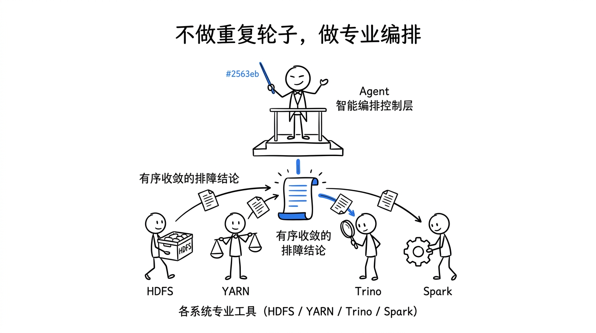
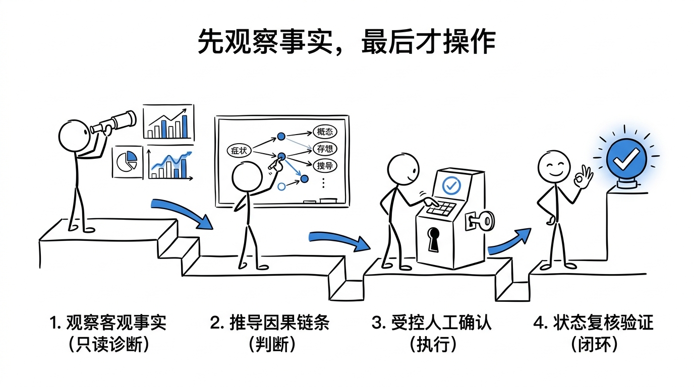
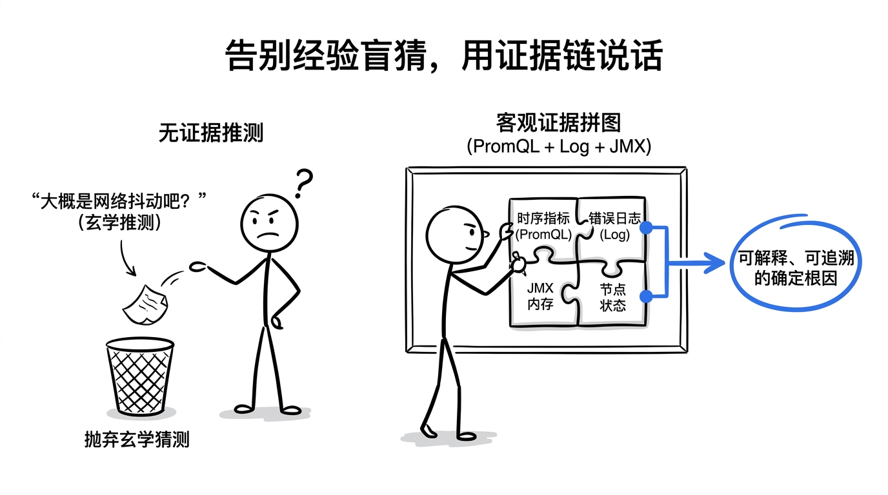
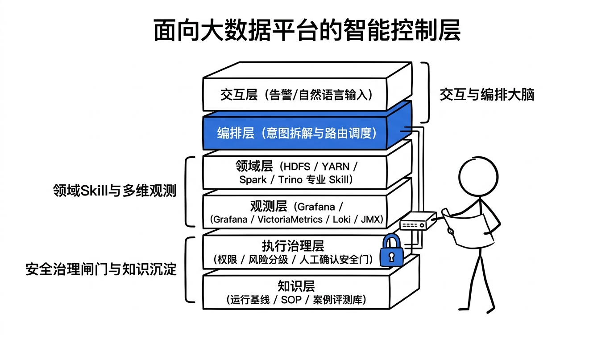

# 🚀 GZH Article Pipeline (微信公众号全自动推文生产与发布流水线)

[](LICENSE)
[](https://github.com/openai/codex)
[](https://deepmind.google)
[](https://mp.weixin.qq.com)
[](https://github.com/lukaizj/gzh-article-pipeline)

> **把文章链接、演讲稿或技术文档，一键转化为带火柴人插图、深度去 AI 味、排版精致并直推微信公众号草稿箱的爆款推文。**

---

## 💡 为什么需要这个 Skill？

传统的 AI 写公众号推文往往存在以下痛点：
1. **AI 味浓厚**：充斥着“不仅……而且……”、“在这个数字化转型的时代”、“至关重要”等假大空废话，缺乏真实一线工程质感；
2. **配图与内容割裂**：使用泛化的 AI 绘画或生硬的架构图，读者看不懂也记不住；
3. **排版繁琐脆弱**：排版工具格式混乱，复制粘贴进公众号经常丢失边框、代码高亮和样式；
4. **人工搬运繁重**：每次都要手动下载图片、上传公众号后台、一张张替换、排版、存草稿。

**`gzh-article-pipeline` 将 3 个专业 Skill 与微信官方 API 打通，提供确定性、高品质的推文创作与发布闭环。**

---

## 🏗️ 核心工作流 (4 阶段)

```text
[用户输入] (文章链接 / Markdown / 演讲稿)
   │
   ▼
[阶段 1: 视觉锚点规划] (基于 stick-figure-illustrations)
   ├─ 提炼核心认知转折点
   ├─ 输出 16:9 火柴人草图规划表 (Shot List)
   └─ ⏸️ 强制停顿，等待用户确认
   │
   ▼ (用户确认后)
[阶段 2: 深度去 AI 味撰写] (基于 humanizer-zh)
   ├─ 去除所有 LLM 机械套话
   └─ 注入真实一线实战口吻，讲深讲透
   │
   ▼
[阶段 3: 视觉生成与内刊排版] (基于 gzh-design-skill)
   ├─ 批量生成 16:9 白底极简火柴人插图
   ├─ 组装「橄榄手记」/「摸鱼绿」内联样式 HTML
   └─ 100% 格式合规校验 (<span leaf=""> 0 Warning)
   │
   ▼
[阶段 4: 一键推送草稿箱] (WeChat API 直连)
   ├─ 自动上传封面素材 (thumb_media_id)
   ├─ 自动上传正文插图至微信 CDN 并替换 HTML
   └─ 提交 draft/add 并返回草稿箱 Draft Media ID
```

---

## 🎨 视觉风格展示：火柴人动作隐喻

本流水线采用统一的 `16:9` 极简黑线 + 科技蓝/终端绿点缀色手绘火柴人风格：

| 图 1：不做重复轮子，做专业编排 | 图 2：科学排障四步法 |
| :---: | :---: |
|  |  |
| **图 3：告别盲猜，用证据链说话** | **图 4：面向大数据的智能控制层** |
|  |  |

---


---

## 🌟 核心工程特性 (Core Engineering Highlights)

1. **五层叙事剧场版封面工作流 (5-Tier Editorial Architecture)**：
   - 告别单调大黄底与营销号式排版，采用科技杂志特刊级视觉规范（场景标签 + 醒目大标 + 具象副标 + 权威黑金徽章 + 利益药丸）；
   - **2.35:1 居中安全视窗防切字算法**：自动识别图像边缘并执行居中安全缩放与纯色背景扩展，确保手机订阅号消息流大图 100% 完整露字不切头。

2. **微信富文本 CSS 清洗防御机制 (Zero-CSS-Loss Engine)**：
   - 纯内联样式架构，彻底杜绝单引号导致的微信服务端转义清空 `style=""` 恶性 Bug；
   - 移动端 100% 自适应，保障暗夜状态卡、双色细线对照表与蓝边引言全端渲染完美。

3. **零门槛自然语言操控体系**：
   - 无需编写任何代码或操作繁琐软件，附带 [《日常使用大白话指令卡》](CLIENT_PROMPT_CARD.md)，只需在 AI 对话框中发送自然语言指令，即可自动完成高颜值排版、原生作图并秒级送达微信公众平台草稿箱。

## 📦 安装与配置

### 1. 安装 Skill

#### 方式 A：直接让 Codex / Antigravity 安装
将本项目 GitHub 链接发送给你的 AI Assistant：
```text
请帮我安装这个 skill：
https://github.com/lukaizj/gzh-article-pipeline
```

#### 方式 B：本地源码安装
```bash
# 克隆仓库
git clone https://github.com/lukaizj/gzh-article-pipeline.git /tmp/gzh-pipeline

# 安装到 Codex
mkdir -p "${CODEX_HOME:-$HOME/.codex}/skills"
cp -R /tmp/gzh-pipeline/gzh-article-pipeline "${CODEX_HOME:-$HOME/.codex}/skills/"

# 安装到 Antigravity (可选软链接)
mkdir -p "$HOME/.gemini/antigravity/skills"
ln -sf "${CODEX_HOME:-$HOME/.codex}/skills/gzh-article-pipeline" "$HOME/.gemini/antigravity/skills/gzh-article-pipeline"
```

---

### 2. 配置微信公众号凭证 (可选)

如果你希望开启**「阶段四：一键自动直推草稿箱」**，请配置你的微信公众号开发者凭证（需在公众号后台加白本机 IP）：

#### 方式 1：配置文件
复制 `references/config.example.json` 为 `references/config.json`：
```json
{
  "appid": "your_wechat_appid",
  "appsecret": "your_wechat_appsecret",
  "default_author": "你的公众号作者名"
}
```

#### 方式 2：环境变量
```bash
export WECHAT_APPID="your_wechat_appid"
export WECHAT_APPSECRET="your_wechat_appsecret"
```

---

## 🚀 快速上手示例

在对话中输入：

```text
Use $gzh-article-pipeline 帮我写这篇公众号文章：

https://example.com/some-tech-article-or-doc
```
或：
```text
用 gzh-article-pipeline 流水线，根据下面这篇架构文档写一篇公众号推文：

<粘贴文章或附带本地 Markdown 文件路径>
```

---

## ☕ 赞赏支持与交流合作 (Sponsorship & Contact)

> **开源不易，如果本项目为您或团队省下了宝贵的排版时间与昂贵的第三方编辑器会员费，欢迎请作者喝杯咖啡！您的支持是本项目持续迭代与开源的最大动力。**

| ☕ 微信赞赏支持 (Buy Me a Coffee) | 💬 主理人微信 (交流群 / 商业定制) |
| :---: | :---: |
|  |  |
| **觉得好用，请作者喝杯冰美式 ☕** | **扫码添加作者微信（技术交流 / 专属定制）** |

- 🛠️ **专属交钥匙部署与品牌定制服务**：如果您是企业、自媒体团队或高频博主，日常发文量大但不想折腾 Python 环境、服务器 IP 白名单与微信接口调试，提供 30 分钟远程 1v1 极速部署、独家品牌视觉卡片定制交付服务；
- 💬 **添加微信号**：`lukai391424`（备注：`智能体部署` 或 `技术交流`）。

---

## 📄 开源许可证

本项目基于 [MIT License](LICENSE) 开源。欢迎 Star ⭐️ 与 PR！
