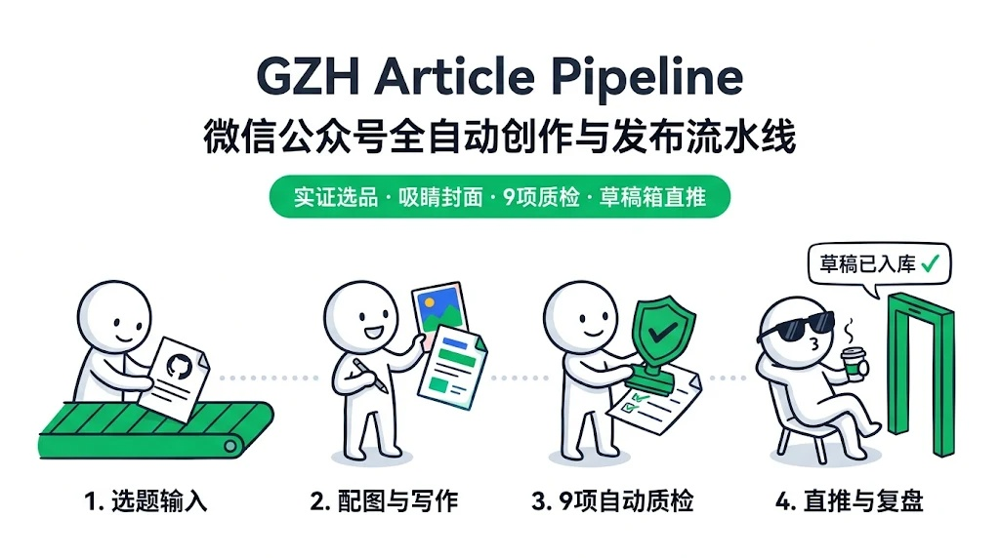
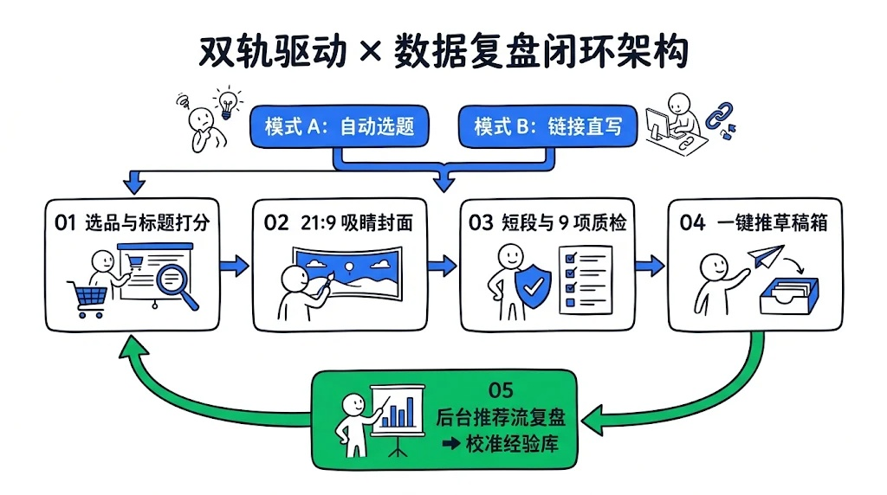
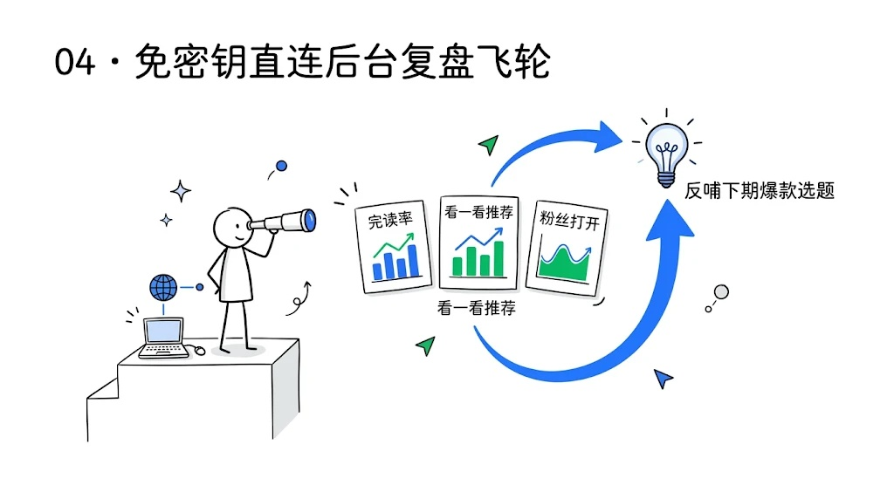

# GZH Article Pipeline

<p align="center">
  <strong>简体中文</strong> • <a href="README.en.md">English</a>
</p>

<p align="center">
  
</p>

<p align="center">
  <a href="LICENSE"></a>
  <a href="https://github.com/openai/codex"></a>
  <a href="https://deepmind.google"></a>
  <a href="https://docs.anthropic.com/en/docs/claude-code"></a>
  <a href="https://mp.weixin.qq.com"></a>
  <a href="https://github.com/lukaizj/gzh-article-pipeline/stargazers"></a>
</p>

<p align="center">
  <b>从选题、剧情封面、千字短段排版到草稿直推与后台复盘的公众号 Skill 流水线</b><br>
  <sub>基于「奇点造物所」近 180 篇实操数据打磨，支持 Codex / Antigravity / Claude Code 直接调用。</sub>
</p>

<p align="center">
  <a href="#真实效果-showcase">真实效果</a> •
  <a href="#核心能力-features">核心能力</a> •
  <a href="#快速上手-quick-start">快速上手</a> •
  <a href="#安装配置-installation">安装配置</a> •
  <a href="#交流支持-contact">交流支持</a>
</p>

---

## 真实效果 (Showcase)

流水线直接生成并推送至公众号后台的**真实草稿箱成稿**（非概念图，仅存草稿箱不擅自群发）：

<p align="center">
  
</p>

---

## 核心能力 (Features)

- **双高选题 & 标题门禁**：核查项目近况防推僵尸仓，按高 eCPM 赛道选品；标题 `<= 26` 字四维打分（`< 75` 分打回），剔除劝退黑话。
- **短段排版 & 9 项质检**：锁定 `950~1300` 纯汉字与手机端 2–3 行短段保完读率；`validate_article.py` 离线扫描套话、违禁词与内联结构。
- **剧情 `21:9` 封面 & 429 容灾**：一文一剧情实景满版封面告别留白同质化；API 遇 `429` 限流自动接管本机 Chrome Gemini 网页版出图。
- **图文 / 小绿书防裁切直推**：纯内联 HTML 上云防掉样式，支持 `--update-draft` 原地覆盖；`upload_newspic.py` 内置安全区封壳与回拉 `203×270` 验图。
- **免密钥后台复盘飞轮**：无需 `appid`/`appsecret`，直接复用本机 Chrome 登录态拉取完读率与推荐流分布，反哺下期选题。

<details>
<summary><strong>展开查看：闭环架构图、4 大模块图解与 180 篇实证规则</strong></summary>

<br>

```text
[自动挖题 / 给定链接]
       │
       ▼
[21:9 封面 (API + 429网页接管)] ➔ [千字内联排版 + 9项离线质检] ➔ [upload_to_wechat 推草稿箱]
       ▲                                                                            │
       └────────── [经验库 JSON] ◄────── [pull_and_analyze_mp 免密钥复盘] ◄─────────┘
```

<p align="center">
  
</p>

| 选品核验与标题评分 | `21:9` 封面与 `429` 容灾 |
| :---: | :---: |
|  |  |
| **短段排版与 9 项离线质检** | **免密钥直连后台数据复盘** |
|  |  |

> 图 02 中的“Web Pro 自动接管”即复用本机已登录 Chrome 的 Gemini 网页版会话。

**近 180 篇后台数据沉淀的 3 条关键规律：**
1. **三道递进闸门**：算法依次卡「`0~30m` 公域 CTR ➔ `30~120m` 完读率 ➔ `2~24h` 分享率」，前一关未过直接熔断。
2. **高分享 ≠ 能进推荐流**：实测某篇 2,600 字路由器教程分享率高达 `25.96%`，但因门槛词 + 过长导致“收藏吃灰”中途跳出（完读 `< 20%`），推荐流仍为 `0.0%`——这是死卡千字短段的原因。
3. **双高 eCPM × CTR**：优先办公、金融、知识类高单价题材，用零门槛痛点动作做标题外层包装。

</details>

---

## 快速上手 (Quick Start)

| 场景 | 对 AI 说 / 终端命令 | 说明 |
| :--- | :--- | :--- |
| **找选题** | `今天选个题` | 结合历史数据输出 3 个高匹配候选方向 |
| **写一篇** | `用 gzh-article-pipeline 写这篇：<URL>` | 验活、写稿、配图、9 项质检并推草稿箱 |
| **发小绿书** | `用 gzh-article-pipeline 发一篇小绿书：<主题>` | `<= 20` 字标题、安全区封壳与实测卡片验图 |
| **离线质检** | `python3 gzh-article-pipeline/scripts/validate_article.py --input article.html --title "标题"` | 零密钥直接输出 9 项质检与标题评分 |
| **后台复盘** | `python3 wechat-content-analysis/scripts/pull_and_analyze_mp.py --limit 30` | 本机 Chrome 登录 `mp.weixin.qq.com` 即可出数 |

> 不会记参数？直接复制 [`CLIENT_PROMPT_CARD.md`](CLIENT_PROMPT_CARD.md) 里的 6 组大白话指令发给助手即可。

---

## 安装配置 (Installation)

**一句话让 AI 自动安装：**
```text
请帮我安装这个 skill：https://github.com/lukaizj/gzh-article-pipeline
```

<details>
<summary><strong>手动安装、多平台路径、运行门槛与目录结构</strong></summary>

**1. 分级使用门槛**
- **零配置**：`Python 3.9+` 即可运行 `validate_article.py` 离线质检与 `olive_journal_template.py` 排版。
- **推草稿箱**：安装 `pip3 install -r requirements.txt`（`requests`, `Pillow`），复制 [`config.example.json`](gzh-article-pipeline/references/config.example.json) 为 `config.json` 填入 `appid`/`appsecret` 并配置公众号后台 IP 白名单（或设环境变量 `WECHAT_APPID` / `WECHAT_APPSECRET`）。
- **免密钥复盘 & 429 网页接管**：需 **macOS + Google Chrome**（保持登录 `mp.weixin.qq.com` / `gemini.google.com`）。

**2. 手动安装命令**
```bash
git clone https://github.com/lukaizj/gzh-article-pipeline.git /tmp/gzh-pipeline
SKILLS_DIR="${CODEX_HOME:-$HOME/.codex}/skills"   # Claude Code 用 ~/.claude/skills；Antigravity 用 ~/.gemini/antigravity/skills
mkdir -p "$SKILLS_DIR"
cp -R /tmp/gzh-pipeline/gzh-article-pipeline /tmp/gzh-pipeline/wechat-content-analysis "$SKILLS_DIR/"
pip3 install -r /tmp/gzh-pipeline/requirements.txt
```

**3. 仓库结构**
```text
gzh-article-pipeline/
├── CLIENT_PROMPT_CARD.md                     # 日常大白话指令卡（中/英）
├── requirements.txt                          # requests / Pillow
├── gzh-article-pipeline/                     # 全流程主 Skill
│   ├── SKILL.md
│   ├── scripts/                              # upload_to_wechat / upload_newspic / validate_article / gemini_web_bridge / pull_and_analyze_mp
│   └── references/                           # topic_selection / writing_playbook / visual_system / olive_journal_template
└── wechat-content-analysis/                  # 独立公众号后台复盘 Skill
```

</details>

---

## 交流支持 (Contact)

本地运行，`.gitignore` 默认屏蔽 `config.json`、`account_empirical_profile.json` 与 Token 缓存；MIT 协议开源，欢迎 [Issue](https://github.com/lukaizj/gzh-article-pipeline/issues) / PR 或 [Star](https://github.com/lukaizj/gzh-article-pipeline) 支持。

<table>
  <tr>
    <th align="center" width="50%">公众号：奇点造物所</th>
    <th align="center" width="50%">主理人微信（备注 <code>开源</code> 或 <code>部署</code>）</th>
  </tr>
  <tr>
    <td align="center"></td>
    <td align="center"></td>
  </tr>
</table>

<details>
<summary><strong>微信交流群与赞赏支持</strong></summary>

| AI 好用工具交流群 | 赞赏支持 |
| :---: | :---: |
|  |  |
| **扫码入群（过期请加主理人微信备注 <code>开源</code> 拉群）** | **觉得省时，请作者喝杯冰美式** |

</details>
