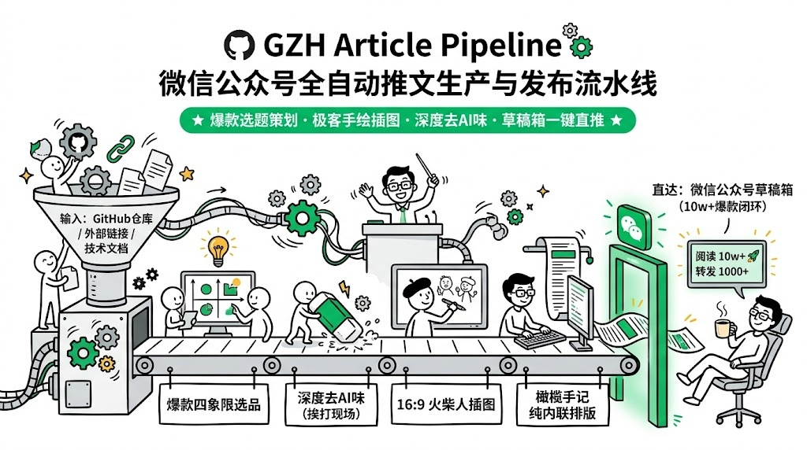
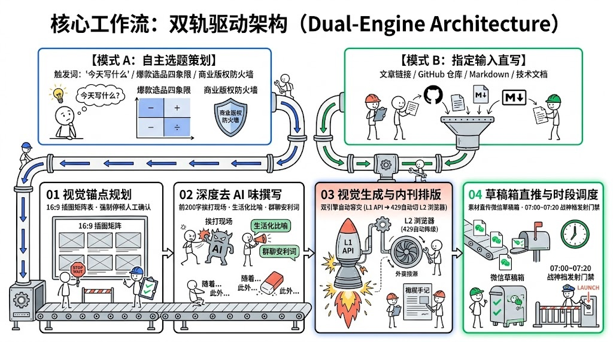
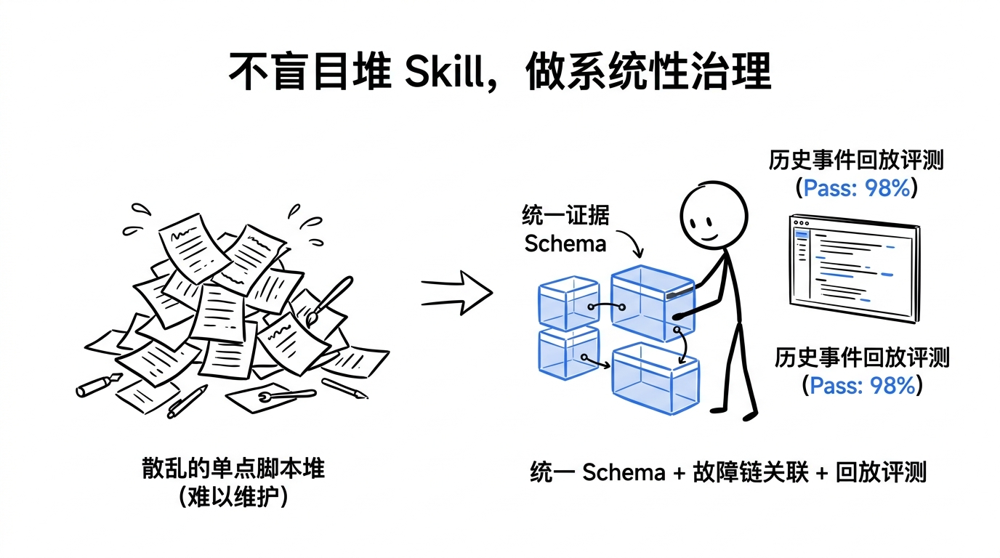

# GZH Article Pipeline

<p align="center">
  
</p>

<p align="center">
  <a href="LICENSE"></a>
  <a href="https://github.com/openai/codex"></a>
  <a href="https://deepmind.google"></a>
  <a href="https://mp.weixin.qq.com"></a>
  <a href="https://github.com/lukaizj/gzh-article-pipeline"></a>
</p>

<p align="center">
  <b>微信公众号全自动推文生产与发布流水线</b><br>
  <span>从零自主策划高转化爆款选题，或直接输入文章链接/技术文档，一键转化为带手绘火柴人插图、深度去 AI 味、排版精致并直推微信公众号草稿箱的工业级推文。</span>
</p>

<p align="center">
  <a href="#痛点与解决方案-overview">核心价值</a> •
  <a href="#核心工作流双轨驱动架构-dual-engine-architecture">架构全景</a> •
  <a href="#视觉设计体系-design-system">视觉体系</a> •
  <a href="#核心工程特性-core-engineering-highlights">工程特性</a> •
  <a href="#快速上手-quick-start">快速上手</a> •
  <a href="#安装与配置-installation">安装配置</a> •
  <a href="#商务合作与技术支持-contact--services">合作支持</a>
</p>

---

## 痛点与解决方案 (Overview)

传统的 AI 公众号写作往往存在严重的质量断层与繁琐的人工搬运成本，本项目提供工业级全自动闭环：

| 维度 | 传统痛点 | 流水线方案 |
| :--- | :--- | :--- |
| **选题选品** | 不知读者痛点，盲目撰写底层冷门库，完读与转化惨淡 | **实战大数据选品**：沉淀 127 篇 6.2w 阅读四大母题，内置大厂商业版权防火墙 |
| **文风质感** | 充斥“在这个数字化时代”、“不仅而且”等浓厚假大空套话 | **深度去 AI 味**：前 200 字真实受害现场还原，生活化比喻拆解，坦白 20% 局限 |
| **配图视觉** | 泛化的 AI 写实图或冰冷代码截图，读者看不懂且无记忆点 | **极简手绘火柴人**：16:9 动作隐喻叙事 + 2.35:1 剧场版居中防切字算法封面 |
| **格式排版** | 格式脆弱，粘贴经常丢失样式、边框崩溃、单引号被微信过滤 | **纯内联 CSS 引擎**：0 单引号防清洗，全端自适应暗夜状态卡与物证对比大表 |
| **发布交付** | 手动下载图片、逐张上传、复制代码、调整样式，极其耗时 | **草稿箱一键直推**：微信官方 API 直传永久素材与正文图，秒级入库草稿箱 |

> [!NOTE]
> **`gzh-article-pipeline`** 将 3 个专业 Skill（爆款选题策划、火柴人排版生图、微信推送引擎）深度打通，提供从**「灵感/输入」**到**「微信草稿箱」**的开箱即用工业级全自动闭环。

---

## 核心工作流：双轨驱动架构 (Dual-Engine Architecture)



### 全自动流水线时序

```text
[模式 A: 灵感选品] ──┐
                     ├──► [01 视觉锚点规划] ──► [02 深度去 AI 味撰写] ──► [03 视觉生成与排版] ──► [04 草稿箱直推与时段调度]
[模式 B: 指定输入] ──┘      (16:9 场景规划表)     (受害现场+生活化比喻)    (API/网页双引擎生图)      (07:00~07:20 晨间发射门禁)
```

1. **双轨灵活输入**：
   - **模式 A（自主选题策划）**：零输入触发，“今天写什么”，秒级输出 3 套爆款选题与黄金标题。
   - **模式 B（指定输入直写）**：支持传入 GitHub 仓库、技术文档、公众号链接、Markdown 或视频逐字稿。
2. **01 视觉锚点规划**：提炼认知转折点与冲突，生成 16:9（2.35:1 居中视窗）插图规划表，强制停顿确认。
3. **02 深度去 AI 味撰写**：前 200 字还原受害者挨打现场，生活化比喻拆解原理，文末预埋现成群聊安利词。
4. **03 视觉生成与内刊排版**：L1 API 极速生图 + 遇 429 自动无缝降级 L2 网页原生桥接，组装「橄榄手记」纯内联 HTML。
5. **04 草稿箱直推与时段调度**：微信官方 API 上传永久封面与正文插图，直达草稿箱，并给出 07:00~07:20 黄金发布时段建议。

---

## 视觉设计体系 (Design System)

本流水线采用统一的 **`16:9` 极简黑线 + 科技蓝/终端绿点缀色手绘火柴人风格**（Wired / O'Reilly 科技特刊美学）：

| 图 1：不做重复轮子，做专业编排 | 图 2：科学排障四步法 |
| :---: | :---: |
|  |  |
| **图 3：告别盲猜，用证据链说话** | **图 4：面向大数据的智能控制层** |
|  |  |

<details>
<summary><b>查看更多样张（图 5：系统性工程治理）</b></summary>
<br>

<p align="center">
  
  <br>
  <em>图 5：不盲目堆 Skill，做系统性治理与工程闭环</em>
</p>

</details>

---

## 核心工程特性 (Core Engineering Highlights)

### 1. 数据驱动的高转化选题引擎 (Data-Driven Viral Topic Engine)
- **127 篇 6.2 万真实阅读大数据沉淀**：内置四大高能母题白名单：
  | 核心高能母题 | 历史均阅 | 核心心理账户 | 标杆场景 |
  | :--- | :---: | :--- | :--- |
  | **资源白嫖 / 免限速下载** | **5k+** | 免费、超速、无广告白嫖 | 万能下载器、网盘解析、多平台嗅探 |
  | **安全反诈 / 查底细抓鬼** | **10k+** | 猎奇、恐惧、防御自保 | 局域网抓包、OSINT 背调、流氓软件监控 |
  | **降维搞钱 / 效率自动化** | **2k+** | 偷懒、降本、搞钱副业 | 数据采集、多平台自动分发、无代码提效 |
  | **平替流氓 / 干净装机** | **1k+** | 愤怒、省心、原厂纯净 | PE 系统救砖、强力卸载、去捆绑全家桶 |
- **商业防火墙与版权自杀一票否决门禁**：
  > [!CAUTION]
  > **版权红线**：严禁碰触国内大厂核心护城河（腾讯系 TME 周杰伦/QQ音乐 SVIP、微信外挂、腾讯视频 VIP 等），防范公域推流封杀及微信《4.1.2 内容侵权》直接强删。
- **标题 NLP 暴击词与 26 字符铁律**：标题严格限制在 `<= 26 字符`（彻底消灭移动端消息流折叠截断），强制使用“被...恶心吐了/流氓/坑爹”（均阅 2051.2）、“一键/秒级/1秒”（均阅 2934.9）、“GitHub万星”等高转化词库。
- **单屏物证大表与现成群聊安利词**：排版紧凑的《四维代际对比大表》手机一屏即可完整截屏，文末附带 30~50 字现成安利词，消除读者转发阻力。
- **黄金发文时段门禁调度器 (Timing Gate)**：首选 `07:00~07:20` 晨间战神档（均阅 2250.9，享整整 16 小时公域发酵），警示 `09:30~11:30` 早会死亡重灾区。

---

### 2. 五层叙事剧场版封面规范 (5-Tier Editorial Architecture)
- 告别单调大黄底与营销号式粗暴拼接，采用科技内刊级封面结构：
  $$\text{场景标签} \rightarrow \text{主标题} \rightarrow \text{具象副标} \rightarrow \text{黑金权威徽章} \rightarrow \text{利益药丸}$$
- **2.35:1 居中安全视窗防切字算法**：自动识别图像边缘并执行居中安全缩放与纯色扩展，确保在微信公众号订阅列表的大图流展示中 **100% 完整露字不切头**。

---

### 3. 富文本 CSS 清洗防御机制 (Zero-CSS-Loss Engine)
- **纯内联样式架构**：彻底杜绝单引号导致的微信服务端转义清空 `style=""` 恶性 Bug。
- **全端自适应**：暗夜状态卡、双色细线对照表与蓝边引言全端完美渲染，通过 `<span leaf="">` 0 Warning 格式合规校验。

---

### 4. 生图双引擎与 429 智能容灾逃逸 (Dual-Engine 429 Bypass)
> [!TIP]
> **痛点反差**：普通 AI 写作遇到生图 API 额度超限（`429 Too Many Requests`）通常直接抛错中断，或被迫降级为简陋死板的灰框。

本流水线实现**全自动双引擎热切换**：
- **L1 API 高速通道**：优先调用系统原生 Native API 毫秒级极速渲染；
- **L2 浏览器原生桥接通道 (`gemini_web_bridge.py`)**：遇到 429 配额拦截时，**拒绝中断与违规降级**，全自动无缝唤醒 macOS 原生 AppleScript 桥接引擎，操控已在 Chrome 中保持登录的 Google Gemini (Advanced / Pro) 网页端会话，自动注入 Prompt、等待渲染并提取高精原图；
- **终极收益**：**0 中断、0 额外配额支出、0 视觉质量降级**，保障批量工业化出文 100% 稳定交付。

---

## 快速上手 (Quick Start)

### 场景 1：不知写什么？让 AI 策划高转化爆款选题 (模式 A)
只需在对话框中直接输入：
```text
今天选个题
```
或：
```text
按照爆款准则，结合最近的前沿开源项目，帮我策划 3 个公众号选题，说明为什么容易引发转发。
```

---

### 场景 2：已有文章/项目链接或文档，端到端全自动直写 (模式 B)
直接发送项目链接或文档：
```text
Use $gzh-article-pipeline 帮我写这篇公众号文章：
https://github.com/BCUninstaller/Bulk-Crap-Uninstaller
```
或直接喂入长文：
```text
用 gzh-article-pipeline 流水线，根据下面这篇架构文档写一篇公众号推文并直推草稿箱：
<粘贴文章或附带本地 Markdown 文件路径>
```

---

## 安装与配置 (Installation)

### 1. 安装 Skill

#### 方式 A：直接让 Codex / Antigravity 安装
将本项目 GitHub 仓库地址发送给你的 AI Assistant 即可：
```text
请帮我安装这个 skill：
https://github.com/lukaizj/gzh-article-pipeline
```

#### 方式 B：本地源码安装
```bash
# 1. 克隆仓库
git clone https://github.com/lukaizj/gzh-article-pipeline.git /tmp/gzh-pipeline

# 2. 安装到 Codex Skills 目录
mkdir -p "${CODEX_HOME:-$HOME/.codex}/skills"
cp -R /tmp/gzh-pipeline/gzh-article-pipeline "${CODEX_HOME:-$HOME/.codex}/skills/"

# 3. 安装到 Antigravity (软链接)
mkdir -p "$HOME/.gemini/antigravity/skills"
ln -sf "${CODEX_HOME:-$HOME/.codex}/skills/gzh-article-pipeline" "$HOME/.gemini/antigravity/skills/gzh-article-pipeline"
```

---

### 2. 配置微信公众号凭证 (可选)

> [!NOTE]
> 仅在使用**「阶段四：一键自动直推草稿箱」**时需要配置微信公众号开发者凭证（需在公众号后台 IP 白名单中添加本机公网 IP）。

#### 方式 1：配置文件
复制 `references/config.example.json` 为 `references/config.json`：
```json
{
  "appid": "your_wechat_appid",
  "appsecret": "your_wechat_appsecret",
  "default_author": "你的公众号作者名"
}
```

#### 方式 2：环境变量
```bash
export WECHAT_APPID="your_wechat_appid"
export WECHAT_APPSECRET="your_wechat_appsecret"
```

---

## 商务合作与技术支持 (Contact & Services)

> 开源不易，如果本项目为您或团队省下了宝贵的排版时间与昂贵的第三方编辑器会员费，欢迎请作者喝杯咖啡！您的支持是本项目持续迭代与开源的最大动力。

| 微信赞赏支持 (Buy Me a Coffee) | 主理人微信 (交流群 / 商业定制) |
| :---: | :---: |
|  |  |
| **觉得好用，请作者喝杯冰美式** | **扫码添加作者微信（技术交流 / 专属定制）** |

### 专属企业定制与交钥匙交付服务
如果您是企业、自媒体团队或高频博主，日常发文量大但不想折腾 Python 环境、服务器 IP 白名单与微信接口调试：
- **30 分钟远程 1v1 极速部署**：快速打通本地环境与微信草稿箱 API；
- **独家品牌视觉卡片定制**：量身定制符合您公众号调性的专属火柴人 IP 形象与排版样式；
- **商务合作微信**：`lukai391424`（备注：`智能体部署` 或 `技术交流`）。

---

## 开源许可证 (License)

本项目基于 [MIT License](LICENSE) 开源。欢迎点亮 Star 与提交 PR 贡献！
