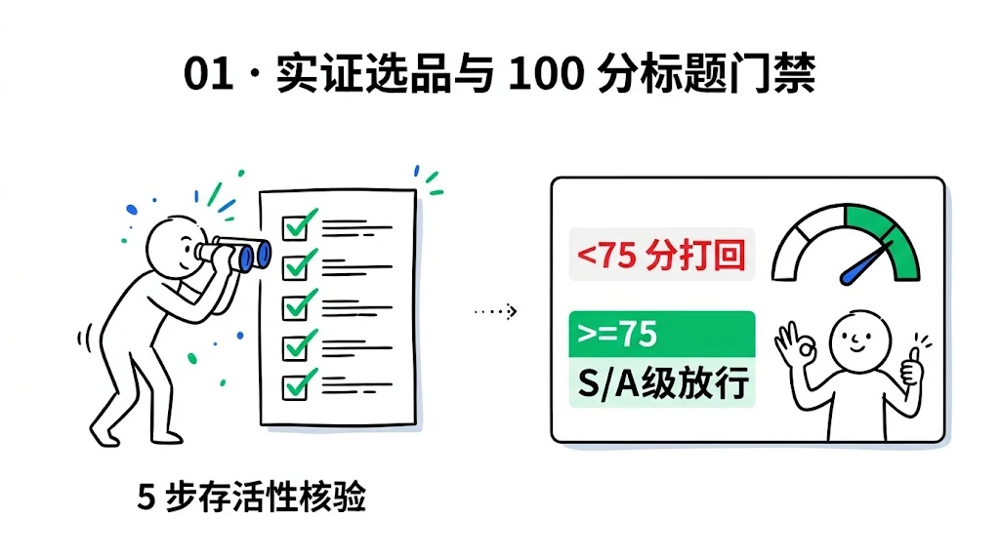
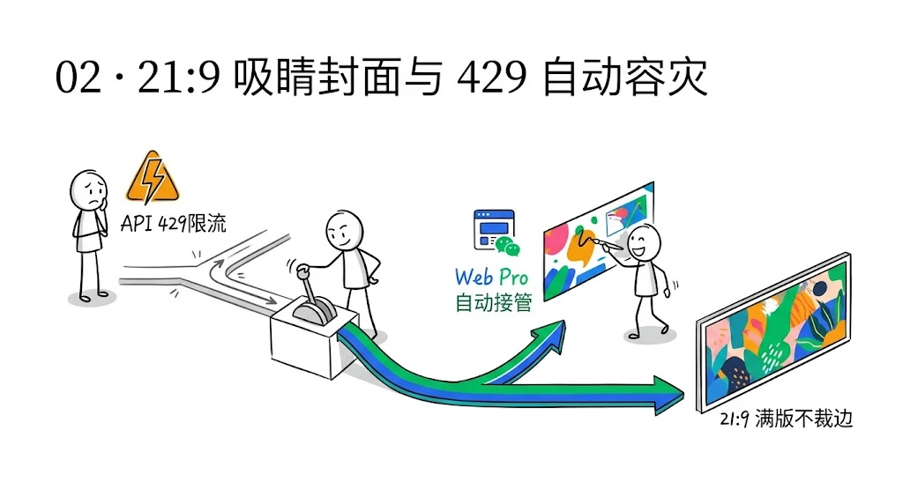
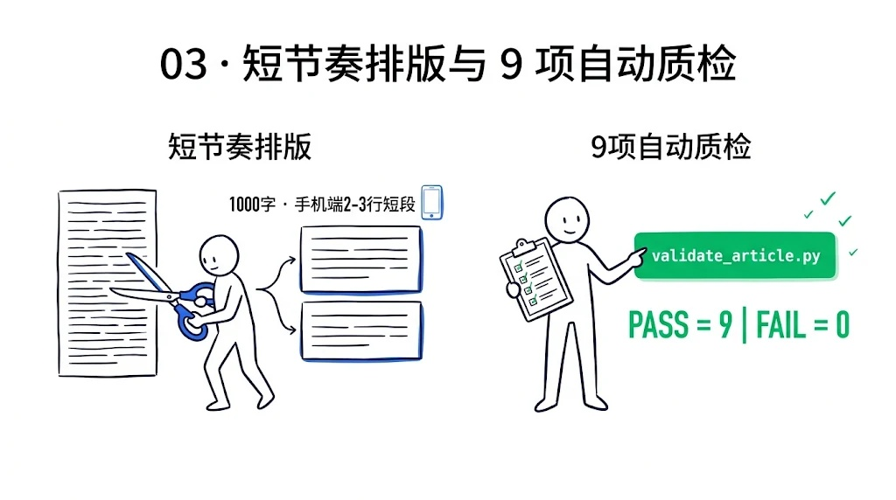

# GZH Article Pipeline

<p align="center">
  
</p>

<p align="center">
  <a href="LICENSE"></a>
  <a href="https://github.com/openai/codex"></a>
  <a href="https://deepmind.google"></a>
  <a href="https://docs.anthropic.com/en/docs/claude-code"></a>
  <a href="https://mp.weixin.qq.com"></a>
  <a href="https://github.com/lukaizj/gzh-article-pipeline/stargazers"></a>
</p>

<p align="center">
  <b>微信公众号创作、离线质检、草稿直推与后台复盘闭环工具链</b><br>
  <span>End-to-end WeChat Official Account skill pipeline for topic gating, 21:9 cover generation, 9-point offline QA, draft publishing, and traffic analytics.</span><br>
  <span>基于公众号「奇点造物所」近 180 篇后台数据打磨的实战工作流，支持 Codex / Antigravity / Claude Code 直接调用。</span>
</p>

<p align="center">
  <a href="#真实产出效果-showcase">效果实景</a> •
  <a href="#功能说明-features">功能说明</a> •
  <a href="#工作流程-architecture">工作流程</a> •
  <a href="#快速使用-quick-start">快速使用</a> •
  <a href="#安装配置-installation">安装配置</a> •
  <a href="#交流与支持-contact">交流支持</a>
</p>

> [!NOTE]
> 如果这套工作流对你的公众号日常产出有帮助，欢迎在右上角点个 [Star](https://github.com/lukaizj/gzh-article-pipeline) 支持后续更新。

---

## 真实产出效果 (Showcase)

以下为本流水线直接生成并推送至微信公众号「奇点造物所」**真实草稿箱**的成稿效果（非概念拼图）：

<p align="center">
  
</p>

- **一文一剧情 `21:9` 满版封面**：每篇按正文场景单独构图配色，彻底告别模板同质化与两侧白边。
- **`<= 26` 字双高标题门禁**：剔除极客黑话与低价引流词，用零门槛痛点动作承接高价值垂直场景。
- **仅推草稿箱，安全可控**：脚本只写入微信草稿箱，不会擅自群发；可在手机端预览微调后再手动发布。

---

## 功能说明 (Features)

针对公众号日常更新里的「选品高阅却低单价、封面同质化留白、粘贴掉样式、小绿书双重裁切及推荐流归因难」等实际痛点，用本地脚本和约束规则串起整条链路：

| 模块 | 解决的问题 | 实现方式 |
| :--- | :--- | :--- |
| **双高选品与标题评分** | 推荐已停更僵尸项目；高阅读低单价“赚吆喝不赚钱”；标题黑话导致冷启动熔断 | • 先核查仓库近况、提交记录与正式安装包，确认可用再写<br>• 按 S/A/C 三级 eCPM 赛道优先级选品，执行「内层高商业语义 × 外层零黑话省钱痛点」双轨包装，按 `<= 26` 字四维打分（`< 75` 分自动重写）并惩罚低单价引流词 |
| **短节奏正文与 9 项质检** | 开头剧透工具名导致收藏即退出、长段落阅读疲劳、AI 套话多 | • 正文锁定 `950~1300` 纯汉字（01 节再揭晓工具名），手机端控制 2~3 行短段，保障 `45%+` 高完读率带出文中与文末广告位<br>• `validate_article.py` 离线扫描段长、套话、词边界违禁词与 `<span leaf="">` 结构完整性 |
| **剧情实景 `21:9` 封面与 429 容灾** | 封面套娃同质化、左右留白过多；生图 API 限流卡断流程 | • 结合正文具体剧情动作定制一文一实景构图，优先经 `gemini_web_bridge.py` 直出原生 `21:9`（`1024×434`）满版无留白封面并 `--no-safe-crop` 直传<br>• `generate_image_unified.py` 遇 `429` 配额报错自动无缝接管本机 Chrome Gemini 网页版出图 |
| **图文直推与小绿书防裁切** | 编辑器吞外链 CSS；小绿书（`newspic`）标题超 20 字截断及双重居中裁切废图 | • `olive_journal_template.py` + `upload_to_wechat.py` 全内联输出并传图至 CDN，支持 `--update-draft` 原地覆盖与每日单发防稀释调度<br>• `upload_newspic.py` 强制 `<= 20` 字标题校验、中心安全区封壳，并在推送后自动回拉线上真实 `thumb_url` 生成 `203×270` 卡片验图 |
| **免密钥后台复盘飞轮** | 发完只看总阅读，搞不清卡在点开率、完读率还是广告单价 | • **无需 `appid` / `appsecret`**，`pull_and_analyze_mp.py` 直接复用本机 Chrome 登录会话拉取单篇完读率与推荐渠道分布<br>• 自动将近期规律写回 `account_empirical_profile.json`，供下一篇选题与排期校准 |

<details>
<summary><strong>为什么这样设计？近 180 篇后台数据总结的 3 条硬规律</strong></summary>

1. **三道递进闸门定律（串联一票否决）**：微信推荐流按时间线依次考核「`0~30` 分钟公域 CTR ➔ `30~120` 分钟完读率 ➔ `2~24` 小时分享率」，前一关未过，后面指标再高也会直接熔断。
2. **高分享 ≠ 能进推荐流（真实踩坑标本）**：我们实测过一篇路由器工具文（181 阅 / 47 分享，**分享率高达 `25.96%`**），但因标题出现高门槛词且正文长达 2,600 字导致大量读者“先收藏再看”中途跳出，完读率跌破 20%，最终公域推荐流为 **`0.0%`**。这也是系统死卡 `950~1300` 字与 `< 75` 分标题打回的直接原因。
3. **双高 eCPM × CTR 模型**：同样 1 万阅读，办公文档/金融盯盘/知识图谱类赛道的广告 eCPM 远高于纯通用下载或清理小工具；在选题门禁阶段就先过商用价值筛子，再用零门槛动作做标题包装。

</details>

---

## 工作流程 (Architecture)

```text
[自动挖题 / 给定链接]
       │
       ▼
[封面与配图 (API + 429网页接管)] ➔ [千字短段排版 + validate_article 9项质检] ➔ [upload_to_wechat 推草稿箱]
       ▲                                                                                     │
       └────── [经验库 account_empirical_profile.json] ◄── [pull_and_analyze_mp 免密钥复盘] ◄─┘
```


| 选品核验与标题评分 | `21:9` 封面与 `429` 容灾 |
| :---: | :---: |
|  |  |
| **短段排版与 9 项离线质检** | **免密钥直连后台数据复盘** |
|  |  |

> 注：图 02 中的“Web Pro 自动接管”即通过本机已登录的 Chrome Gemini 网页版会话进行自动容灾出图。

---

## 快速使用 (Quick Start)

| 场景 | 对助手说 / 终端执行 | 说明 |
| :--- | :--- | :--- |
| **寻找选题** | `今天选个题` | 参考历史数据筛选 3 个高匹配候选方向及标题 |
| **按链接成稿** | `用 gzh-article-pipeline 写这篇：<URL>` | 核查项目可用性后自动写稿、配图、质检并推至草稿箱 |
| **小绿书发图** | `用 gzh-article-pipeline 发一篇小绿书：<主题/图片>` | 强制 `<= 20` 字标题、安全区封壳与回拉 `203×270` 验图 |
| **离线质检** | `python3 gzh-article-pipeline/scripts/validate_article.py --input article.html --title "你的标题"` | 无需任何密钥，直接输出 9 项质检与标题四维评分 |
| **免密钥复盘** | `python3 wechat-content-analysis/scripts/pull_and_analyze_mp.py --limit 30` | macOS 本机 Chrome 保持登录 `mp.weixin.qq.com` 即可出分渠道明细 |

> [!TIP]
> **不想记命令行或参数？** 可以直接打开 [`CLIENT_PROMPT_CARD.md`](CLIENT_PROMPT_CARD.md)，复制里面的大白话指令模板发给 AI 助手即可。

<details>
<summary>目录结构</summary>

```text
gzh-article-pipeline/
├── CLIENT_PROMPT_CARD.md                     # 日常使用大白话指令卡（6 类场景即复制即用）
├── requirements.txt                          # Python 可选第三方依赖（requests / Pillow）
├── gzh-article-pipeline/                     # 全流程创作与发布主 Skill
│   ├── SKILL.md                              # 全流程总控指令
│   ├── scripts/
│   │   ├── upload_to_wechat.py               # 微信图文草稿箱直推 (--no-safe-crop / --update-draft)
│   │   ├── upload_newspic.py                 # 小绿书 (newspic) <=20字校验、安全区封壳与实测卡片验图
│   │   ├── validate_article.py               # 离线 9 项质检、双高标题评分与违禁词检查
│   │   ├── gemini_web_bridge.py              # macOS Chrome Gemini Web 原生 21:9 出图与 429 自动容灾
│   │   ├── generate_image_unified.py         # 生图双引擎统一调度器
│   │   └── pull_and_analyze_mp.py            # 公众号后台渠道数据拉取（主流程内置版）
│   └── references/
│       ├── topic_selection.md                # 双高 eCPM 分级选品与项目存活性检查规范
│       ├── writing_playbook.md               # 非剧透开头、短段节奏与标题评分卡
│       ├── visual_system.md                  # 剧情实景 21:9 封面与小绿书双重裁切视觉规范
│       ├── olive_journal_template.py         # 纯内联 HTML 组件库
│       ├── config.example.json               # 微信凭据配置模板
│       └── account_empirical_profile.example.json
└── wechat-content-analysis/                  # 独立公众号数据复盘 Skill（可单独安装使用）
    ├── SKILL.md
    ├── references/topic_templates.md
    └── scripts/pull_and_analyze_mp.py
```

</details>

---

## 安装配置 (Installation)

### 1. 分级运行环境（按需准备，不必一步全配）

| 使用层级 | 所需环境 / 凭据 | 说明 |
| :--- | :--- | :--- |
| **零配置起步**（质检 & 排版） | `Python 3.9+`（标准库即可） | 可直接运行 `validate_article.py` 与 `olive_journal_template.py` |
| **草稿箱推送**（图文 / 小绿书） | `pip install -r requirements.txt` + 公众号 `appid` / `appsecret` | 需在公众号后台配置本机公网 IP 白名单 |
| **免密钥后台复盘 & 429 网页容灾** | **macOS + Google Chrome**（保持对应网页登录态） | `pull_and_analyze_mp.py` 与 `gemini_web_bridge.py` 通过 AppleScript 复用本机 Chrome 会话 |

### 2. 安装 Skill 到本地助手

**方式 A（通过 Codex / Antigravity / Claude Code 自动安装）：**
```text
请帮我安装这个 skill：https://github.com/lukaizj/gzh-article-pipeline
```

**方式 B（手动命令行安装）：**
```bash
git clone https://github.com/lukaizj/gzh-article-pipeline.git /tmp/gzh-pipeline

# 按你使用的 AI 助手选择对应 skills 目录（以 Codex 为例；Antigravity / Claude Code 见下方路径表）
SKILLS_DIR="${CODEX_HOME:-$HOME/.codex}/skills"
mkdir -p "$SKILLS_DIR"
cp -R /tmp/gzh-pipeline/gzh-article-pipeline "$SKILLS_DIR/"
cp -R /tmp/gzh-pipeline/wechat-content-analysis "$SKILLS_DIR/"

# 如需草稿箱直推与小绿书生图处理，安装轻量依赖
pip3 install -r /tmp/gzh-pipeline/requirements.txt
```

<details>
<summary>常见 AI 助手的 Skills 目录路径对照</summary>

| 工具 | 全局 Skills 目录 |
| :--- | :--- |
| **Codex** | `${CODEX_HOME:-$HOME/.codex}/skills/` |
| **Claude Code** | `~/.claude/skills/` |
| **Antigravity** | `~/.gemini/antigravity/skills/`（或 `~/.gemini/config/skills/`） |

</details>

### 3. 配置微信推送凭据（仅推草稿箱需要，数据复盘脚本免配）

复制 [`gzh-article-pipeline/references/config.example.json`](gzh-article-pipeline/references/config.example.json) 为 `config.json` 并填入 `appid` 与 `appsecret`（需在公众号后台「设置与开发 ➔ 基本配置」中添加本机公网 IP 白名单），或设置环境变量 `WECHAT_APPID`、`WECHAT_APPSECRET`。

---

## 交流与支持 (Contact)

- **本地运行保障**：`.gitignore` 默认忽略 `config.json`、`*.env` 与本地 Token 缓存；排版、质检与后台拉取全部在本机完成，不经过第三方中转服务。
- **MIT 协议**：详见 [LICENSE](LICENSE)，欢迎提 [Issue](https://github.com/lukaizj/gzh-article-pipeline/issues) 或 PR。

关注开源实战更新、反馈需求或技术交流，可以**微信搜一搜「奇点造物所」**或添加主理人微信（长期有效入口）：

<table>
  <tr>
    <th align="center" width="50%">公众号：奇点造物所</th>
    <th align="center" width="50%">主理人微信（备注 <code>开源</code> 或 <code>部署</code>）</th>
  </tr>
  <tr>
    <td align="center">
      
    </td>
    <td align="center">
      
    </td>
  </tr>
</table>

<details>
<summary><strong>微信交流群与赞赏支持</strong></summary>

| 奇点造物所 AI 好用工具交流群 | 赞赏支持 |
| :---: | :---: |
|  |  |
| **扫码入群（若二维码过期，请加主理人微信备注 <code>开源</code> 拉群）** | **觉得省时，请作者喝杯冰美式** |

</details>
