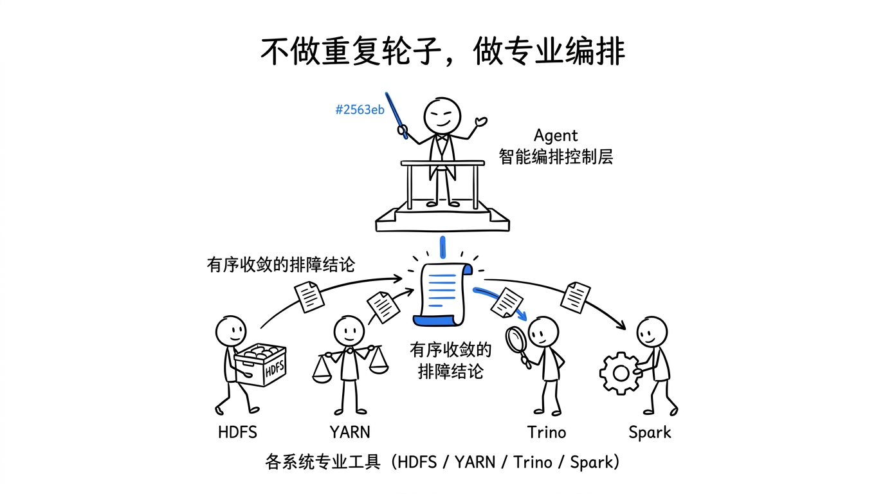
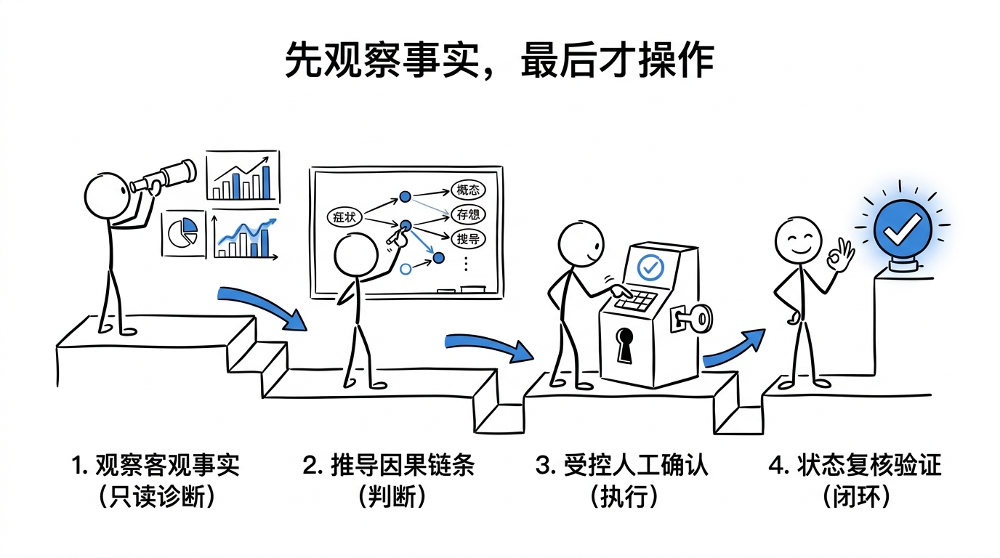
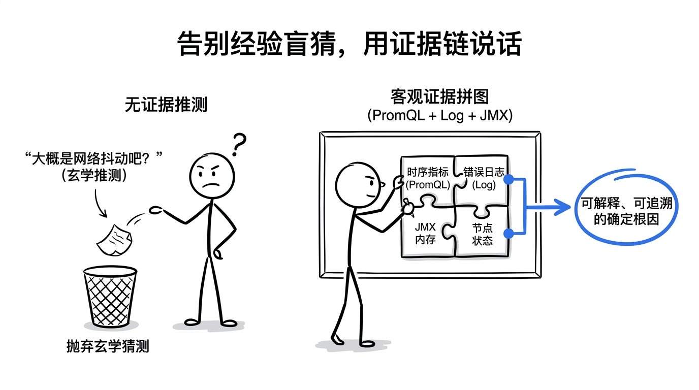
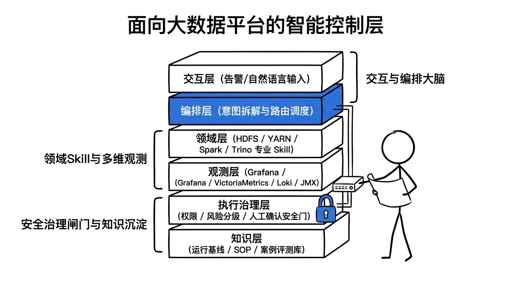

# GZH Article Pipeline

<p align="center">
  
</p>

<p align="center">
  <a href="LICENSE"></a>
  <a href="https://github.com/openai/codex"></a>
  <a href="https://deepmind.google"></a>
  <a href="https://mp.weixin.qq.com"></a>
  <a href="https://github.com/lukaizj/gzh-article-pipeline/stargazers"></a>
  <a href="https://github.com/lukaizj/gzh-article-pipeline"></a>
</p>

<p align="center">
  <b>微信公众号全自动推文生产与发布流水线</b><br>
  <span>从零自主策划高转化爆款选题，或直接输入文章链接/技术文档，一键转化为带差异化火柴人插图、前三句给结论超短段排版、直推草稿箱并打通全渠道数据复盘的工业级推文。</span>
</p>

<p align="center">
  <a href="#痛点与解决方案-overview">核心价值</a> •
  <a href="#核心工作流双核自运转闭环架构-autonomous-closed-loop-architecture">架构全景</a> •
  <a href="#视觉设计体系-design-system">视觉体系</a> •
  <a href="#核心工程特性-core-engineering-highlights">工程特性</a> •
  <a href="#快速上手-quick-start">快速上手</a> •
  <a href="#项目结构概览">项目结构</a> •
  <a href="#安装与配置-installation">安装配置</a> •
  <a href="#商务合作与技术支持-contact--services">合作支持</a>
</p>

> [!TIP]
> 💡 **如果这套流水线帮您省下了每天排版的 1 小时，欢迎顺手在右上角点个 ⭐️ [Star](https://github.com/lukaizj/gzh-article-pipeline) 支持，这是作者持续开源维护的最大动力！**

---

## 痛点与解决方案 (Overview)

传统的 AI 公众号写作往往存在开头流失严重、长段落手机阅读疲劳与繁琐的人工排版搬运成本，本项目提供工业级全自动闭环：

| 维度 | 传统痛点 | 流水线方案 |
| :--- | :--- | :--- |
| **选题选品** | 不知读者痛点，盲目撰写底层冷门库，完读与转化惨淡 | **实战大数据选品**：沉淀 **175 篇 16 万+ 阅读**实战规律，内置动态存活性死刑复核与版权防火墙 |
| **结构节奏** | 前两百字还在啰嗦背景、大段文字墙导致手机端中途划走 | **高完读拆短排版**：**前三句直接给结论**，每段手机端 **2～3 行（35～55 字）**、一段一意、轻结尾收口 |
| **配图视觉** | 单一灰底审美疲劳或泛化写实图，缺乏点击记忆点 | **白火柴人多风格矩阵**：差异化色系 `21:9` 原生防切字封面 + 每约 **300 字** 穿插直观图文/实机图 |
| **格式排版** | 格式脆弱，粘贴经常丢失样式、边框崩溃、单引号被微信过滤 | **纯内联 CSS 引擎**：0 单引号防清洗，全端自适应暗夜卡片、对照大表与文末官方名片自动兜底 |
| **发布交付** | 手动传图调样式耗时，反复重改草稿导致版式错乱 | **草稿箱一键直推**：微信官方 API 直传素材，`--no-safe-crop` 满版推图，支持 `--update-draft` 原地覆盖 |
| **数据复盘** | 生产与收入脱节，不知流量死因与广告位漏水点 | **全渠道与商业复盘闭环**：一键拉取阅读、推荐流、广告位到达率与 eCPM，持续反哺经验画像库 |

> [!NOTE]
> **`gzh-article-pipeline`** 将创作生产引擎与后台全渠道及变现数据复盘深度打通，提供从**「实证选品策划」**到**「草稿箱直推」**再到**「数据自愈反哺」**的开箱即用工业级全自动闭环。

---

## 核心工作流：双核自运转闭环架构 (Autonomous Closed-Loop Architecture)


### 全自动闭环时序

```text
[模式 A: 灵感选品] ──┐
                     ├──► [01 视觉锚点规划] ──► [02 高完读拆短撰写] ──► [03 差异化生图与排版] ──► [04 草稿箱直推] ──┐
[模式 B: 指定输入] ──┘      (21:9 差异化矩阵)     (前三句给结论+2~3行短段)   (API/浏览器双引擎生图)      (07:00~07:20 门禁)     │
       ▲                                                                                                            │
       └───────────────────────── [全渠道与流量主穿透复盘 ➔ 经验画像 account_empirical_profile.json] ◄─────────────┘
                                   (pull_and_analyze_mp.py 微信推荐流 / 广告位到达率 / eCPM 归因校准)
```

1. **双轨灵活输入**：
   - **模式 A（自主选题策划）**：零输入触发，“今天写什么”，秒级输出 3 套爆款选题与黄金标题，自动结合历史实证画像雷达进行公域推荐存活预测。
   - **模式 B（指定输入直写）**：支持传入 GitHub 仓库、技术文档、公众号链接、Markdown 或视频逐字稿。
2. **01 视觉锚点规划**：按文章主题匹配差异化配色（红黑/战情室/宣纸/黑金/薄荷绿），规划 **每 ~300 字一张配图** 的轻视觉节奏与 `21:9` 满版封面方案。
3. **02 高完读去 AI 味撰写**：
   - **开头给结论**：前 3 句话直接交代读者能拿到什么价值、解决什么痛点，背景后置；
   - **手机端极简节奏**：一段只讲一个意思（控制 2～3 行），关键句加粗独立成段，段间空一行；每 300～500 字置入步骤、对照表或金句，结尾一两句轻总结收尾；
   - **严禁正文重复标题与套路引流**：消除双重 H1 标题，严格控制在 **1,000～1,300 汉字**，不放评论区强引导与后台回复暗号卡。
4. **03 视觉生成与内刊排版**：
   - 生图双引擎自动容灾：L1 原生 API 极速生图 ➔ 遇 429 配额限制毫秒级自动切换至 L2 浏览器原生桥接（`gemini_web_bridge.py`）；
   - 橄榄手记纯内联 HTML 组装（`<span leaf="">` 100% 校验），自动在文末植入 `<mp-common-profile>` 公众号官方名片。
5. **04 草稿箱直推与原地覆盖更新**：支持 `--no-safe-crop` 原生 `21:9` 满版直传、新增草稿及 `--update-draft` 原地更新已有草稿，并输出黄金发文时段建议。
6. **双核数据复盘与经验自愈飞轮**：运行 `pull_and_analyze_mp.py` 一键穿透发表数据、推荐流占比、广告位到达率与 eCPM 表现，沉淀实证画像反哺后续选品与商业转化。

---

## 视觉设计体系 (Design System)

本流水线采用统一的 `16:9` 极简黑线 + 科技蓝/终端绿点缀色手绘火柴人风格：

| 调度指挥家 (编排思想) | 四步时序排障 (方法论) |
| :---: | :---: |
|  |  |
| **证据链拼图 (排障质感)** | **六层控制塔 (系统架构)** |
|  |  |

---

## 核心工程特性 (Core Engineering Highlights)

### 1. 实战大数据选品与高完读短节奏引擎
- **175 篇 16 万+ 真实阅读大数据背书**：内置四大高能母题与高转化商业交叉区——硬件设备翻身（如旧平板副屏/串流）、高效率办公平替、资源满速工具与大众实用生活神器；
- **🚨 项目动态存活性死刑复核机制 (Death Penalty Live Health Check)**：彻底杜绝“纸上谈兵、刻舟求剑、迷信历史Star数”。在立项与写作前必须穿透执行 5 步死刑复核（① 仓库主分支源码非空壳；② 近6个月有有效维护；③ Issue 无满屏“失效/无法解密/闪退”；④ 当前最新主流系统/宿主环境如微信4.x实测兼容；⑤ 提供开箱即用 Release 编译包或免安装官网直开入口）。凡空壳仓、作者声明弃坑、宿主改版失效者，**一票否决，直接死刑**！
- **商业防火墙与版权自杀一票否决门禁**：严禁碰触国内大厂（特别是腾讯系 TME 周杰伦/QQ音乐SVIP、腾讯视频 VIP、微信外挂）的核心商业护城河，防范公域推流封杀及《4.1.2 内容侵权》直接强删；
- **标题严格对齐与 26 字符铁律**：标题严格限制在 `<= 26 字符`（防手机列表截断），绝不出现技术黑话，且标题承诺的方法或清单必须在正文 100% 兑现；
- **手机端极速防疲劳正文规范**：**前三句交代核心价值**、**每段 2～3 行（35～55 字）且一段只讲一件事**、关键句加粗独立成段、**每 300 字插直观配图、每 300～500 字留收获卡片/大表**，结尾一两句轻总结收尾；
- **黄金发文时段门禁调度器 (Timing Gate)**：脚本内置自动化时段调度建议，首选 07:00~07:20 晨间战神档（均阅 2250.9，享 16 小时发酵），警示 09:30~11:30 早会死亡重灾区。

### 2. 多风格差异化火柴人封面矩阵与 21:9 原生满版防裁切
- 保留辨识度极高的**纯白光头墨镜火柴人 IP**，按不同文章情绪自动切换差异化配色（红黑警告对比 / 深海战情室 / 古风宣纸卷轴 / 黑金紫电极客 / 清爽薄荷绿），彻底消除订阅号主页千篇一律的审美疲劳；
- 支持按 **`21:9` (`1024×434`)** 原生宽幅直出并搭配 `--no-safe-crop` 满版入库，也兼容 `16:9` 自动居中安全裁切兜底，确保信息流 **100% 完整露字不切头**。

### 3. 富文本 CSS 清洗防御与文末名片兜底 (Zero-CSS-Loss Engine)
- **纯内联样式架构**：彻底杜绝单引号导致的微信服务端转义清空 `style=""` 恶性 Bug；
- **全端自适应**：暗夜状态卡、双色细线对照表与蓝边引言全端完美渲染，通过 `<span leaf="">` 0 Warning 格式合规校验，并自动兜底植入文末互动名片（`<mp-common-profile>`）；
- **消灭正文双重标题**：微信公众平台自带原生置顶大标题与作者栏，正文顶部严禁重复放置 h1 标题块，同时禁用文末强引导留言套话。

### 4. 生图双引擎与 429 智能容灾逃逸 (Dual-Engine 429 Bypass)
> [!TIP]
> **痛点反差**：普通 AI 写作遇到生图 API 额度超限（`429 Too Many Requests`）通常直接抛错中断，或被迫降级为简陋死板的灰框。

本流水线实现**全自动双引擎热切换**：
- **L1 API 高速通道**：优先调用系统原生 Native API 毫秒级极速渲染；
- **L2 浏览器原生桥接通道 (`gemini_web_bridge.py`)**：遇到 429 配额拦截时，**拒绝中断与违规降级**，全自动无缝唤醒 macOS 原生 AppleScript 桥接引擎，操控已在 Chrome 中保持登录的 Google Gemini (Advanced / Pro) 网页端会话，自动注入 Prompt、等待渲染并提取高精原图；
- **终极收益**：**0 中断、0 额外配额支出、0 视觉质量降级**，保障批量工业化出文 100% 稳定交付。

### 5. 全渠道真实数据复盘与经验自愈飞轮 (Empirical Data Closed-Loop)
- **一键穿透发表数据 (`pull_and_analyze_mp.py`)**：直接复用本地 Chrome 浏览器中已打开的微信公众平台标签页，**无需任何 API 凭据或登录态配置**，3~5 秒拉取最近已发文章全渠道真实 UV（推荐算法流、常读私域消息、聊天会话转发、朋友圈、搜一搜）；
- **推荐流熔断 vs 爆款破圈分层对决**：科学归因低阅文章为什么卡在 100~150 阅私域底盘（微信算法前 2 小时初筛，若初始分享率 < 15% 或受众过窄，推荐流会在 50~100 次曝光后直接熔断）；头部爆款（推荐占比 > 85%）的公约数特征；
- **动态经验画像库 (`account_empirical_profile.json`)**：自动持久化账号专属的私域底盘常态区间、推荐爆发分享率阈值、TOP 5 爆款暴击词与近期零推荐避坑黑名单；
- **前置防熔断雷达（Empirical Viability Gatekeeper）**：在阶段 0 选品与阶段 1 拟标题时，主动读取该画像，对选题进行“公域推荐存活率预测”，杜绝小众自嗨题材踩雷。

---

## 项目结构概览

```text
gzh-article-pipeline/
├── gzh-article-pipeline/                  # 🚀 推文创作与发布主流水线
│   ├── SKILL.md                          # 流水线标准指令与阶段规约
│   ├── scripts/
│   │   ├── upload_to_wechat.py           # 微信官方草稿箱直推与素材上传
│   │   ├── gemini_web_bridge.py          # Gemini Web Pro 429 生图容灾桥接器
│   │   ├── generate_image_unified.py     # 统一生图调度分发器
│   │   └── pull_and_analyze_mp.py        # 微信后台发表数据全量拉取与诊断
│   └── references/
│       ├── account_empirical_profile.json# 账号实证经验画像库 (自动更新)
│       ├── account_empirical_profile.example.json # 画像参考模板
│       ├── config.example.json           # 微信接口凭证模板
│       ├── olive_journal_template.py     # 橄榄手记内刊组件库
│       ├── topic_selection.md            # 爆款选品准则与六道门禁指南
│       ├── writing_playbook.md           # 深度去 AI 味写作与三指标埋点
│       ├── visual_system.md              # 封面与插画视觉工程学
│       └── traffic_monetization.md       # 商业广告心流拦截
└── wechat-content-analysis/              # 📊 数据复盘与公私域渠道诊断独立技能
    ├── SKILL.md                          # 复盘专家技能规约
    └── scripts/pull_and_analyze_mp.py    # 渠道分析与画像导出工具
```

---

## 快速上手 (Quick Start)

### 场景 1：不知写什么？让 AI 策划高转化爆款选题 (模式 A)
只需在对话框中直接输入：
```text
今天选个题
```
或：
```text
按照爆款准则，结合本号最近的实证数据画像，帮我策划 3 个公众号选题，说明公域推荐胜率。
```

---

### 场景 2：已有文章/项目链接或文档，端到端全自动直写 (模式 B)
直接发送项目链接或文档：
```text
Use $gzh-article-pipeline 帮我写这篇公众号文章并推送到草稿箱：
https://github.com/BCUninstaller/Bulk-Crap-Uninstaller
```
或直接喂入长文：
```text
用 gzh-article-pipeline 流水线，根据下面这篇架构文档写一篇公众号推文并直推草稿箱：
<粘贴文章或附带本地 Markdown 文件路径>
```

---

### 场景 3：一键全量复盘公众号发表数据与公私域渠道 (复盘模式)
只需在本地 Chrome 中打开微信公众号后台（`mp.weixin.qq.com`）并登录，直接在终端执行：
```bash
# 默认分析最近 30 篇已发表文章并自动同步经验画像库
python3 gzh-article-pipeline/scripts/pull_and_analyze_mp.py --limit 30

# 若需全量拉取全号历史所有文章
python3 gzh-article-pipeline/scripts/pull_and_analyze_mp.py --all
```
或直接在 AI 对话中说：
```text
分析今日公众号数据
```

---

## 安装与配置 (Installation)

### 1. 安装 Skill

#### 方式 A：直接让 Codex / Antigravity 安装
将本项目 GitHub 仓库地址发送给你的 AI Assistant 即可：
```text
请帮我安装这个 skill：
https://github.com/lukaizj/gzh-article-pipeline
```

#### 方式 B：本地源码安装
```bash
# 1. 克隆仓库
git clone https://github.com/lukaizj/gzh-article-pipeline.git /tmp/gzh-pipeline

# 2. 安装到 Codex Skills 目录
mkdir -p "${CODEX_HOME:-$HOME/.codex}/skills"
cp -R /tmp/gzh-pipeline/gzh-article-pipeline "${CODEX_HOME:-$HOME/.codex}/skills/"

# 3. 安装到 Antigravity (软链接)
mkdir -p "$HOME/.gemini/antigravity/skills"
ln -sf "${CODEX_HOME:-$HOME/.codex}/skills/gzh-article-pipeline" "$HOME/.gemini/antigravity/skills/gzh-article-pipeline"
```

---

### 2. 配置微信公众号凭证 (仅草稿箱直推需要)

> [!NOTE]
> 仅在使用**「阶段四：一键自动直推草稿箱」**时需要配置微信公众号开发者凭证（需在公众号后台 IP 白名单中添加本机公网 IP）。复盘工具无需配置任何凭证。

#### 方式 1：配置文件
复制 `gzh-article-pipeline/references/config.example.json` 为 `gzh-article-pipeline/references/config.json`：
```json
{
  "appid": "your_wechat_appid",
  "appsecret": "your_wechat_appsecret",
  "default_author": "你的公众号作者名"
}
```

#### 方式 2：环境变量
```bash
export WECHAT_APPID="your_wechat_appid"
export WECHAT_APPSECRET="your_wechat_appsecret"
```

> 🔒 **特别提示**：`references/config.json` 已在 `.gitignore` 中被严格忽略，**绝对不会上传至 GitHub**，请放心使用。

---

## 🔒 隐私与安全承诺 (Zero Key Leakage Guarantee)

* 🛡️ **绝对凭据安全**：仓库默认通过 `.gitignore` 彻底屏蔽 `config.json`、`*.env` 与任何本地 Token 缓存文件，绝不将您的 AppID / AppSecret 上传至网络；
* ⚡️ **免密钥数据复盘**：`pull_and_analyze_mp.py` 采用原生 AppleScript 桥接架构，直接复用本地 Chrome 浏览器会话中的微信公众平台 Token，**脚本自身零凭证存储、零网络外传**；
* 💻 **本地完全离线可控**：所有 HTML 编译、CSS 内联校验与生图调度均在您本机完成，无第三方中间代理服务。

---

## 商务合作与技术支持 (Contact & Services)

> 💡 **开源不易，如果这套流水线帮您省下了每天排版的 1 小时，欢迎顺手在右上角点个 ⭐️ [Star](https://github.com/lukaizj/gzh-article-pipeline) 支持，这是作者持续开源维护的最大动力！** 也欢迎请作者喝杯冰美式，感谢每一位同行的认可。

| 微信赞赏支持 (Buy Me a Coffee) | 主理人微信 (交流群 / 商业定制) |
| :---: | :---: |
|  |  |
| **觉得好用，请作者喝杯冰美式** | **扫码添加作者微信（技术交流 / 专属定制）** |

### 专属企业定制与交钥匙交付服务
如果您是企业、自媒体团队或高频博主，日常发文量大但不想折腾 Python 环境、服务器 IP 白名单与微信接口调试：
- **30 分钟远程 1v1 极速部署**：快速打通本地环境与微信草稿箱 API；
- **独家品牌视觉卡片定制**：量身定制符合您公众号调性的专属火柴人 IP 形象与排版样式；
- **商务合作微信**：`lukai391424`（备注：`智能体部署` 或 `技术交流`）。

---

## 开源许可证 (License)

本项目基于 [MIT License](LICENSE) 开源。欢迎点亮 Star 与提交 PR 贡献！
